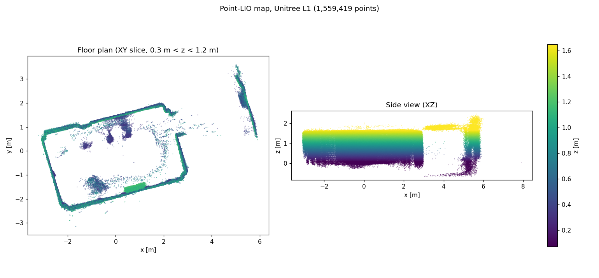

[中文](README.md) | **English**

# Unitree 4D LiDAR L1 bring-up and mapping notes (2026-10-27)

Environment: Ubuntu 24.04, ROS 2 Jazzy; SDK at `~/unilidar_sdk`

Results:
- Live point cloud (`/unilidar/cloud`) shown in rviz2
- [Point-LIO](https://github.com/unitreerobotics/point_lio_unilidar) ported to ROS 2 Jazzy, and used with the L1 to map a room (about 1.56 million points)




## Files
- `README.md`: setup steps and troubleshooting (Chinese)
- `README.en.md`: this file (English)
- `conversation.md`: transcript 1, covering the SDK, rviz2 and the Point-LIO port (Chinese)
- `conversation_2.md`: transcript 2, covering USB troubleshooting and the Point-LIO mapping test (Chinese)
- `config/view.rviz`: rviz2 config, from [unitreerobotics/unilidar_sdk](https://github.com/unitreerobotics/unilidar_sdk)
- `point_lio_ros2/point_lio_ros2_jazzy.patch`: patch that ports Point-LIO to ROS 2 Jazzy
- `images/`: screenshots and map preview

## Get the SDK
Official SDK: <https://github.com/unitreerobotics/unilidar_sdk> (C++ SDK, ROS 1 and ROS 2 packages)
```bash
cd ~
git clone https://github.com/unitreerobotics/unilidar_sdk.git
```
Other downloads (manuals, Windows tools, etc.): <https://www.unitree.com/download>

## Hardware check
- The L1 needs a separate 12V supply. USB only carries data.
- Once connected, `lsusb` should list `10c4:ea60 Silicon Labs CP210x UART Bridge` (the chip is a CP2104)
- Device node: `/dev/ttyUSB0`
- Run `sudo dmesg -w` while plugging it in. You should see `cp210x converter now attached to ttyUSB0`

## Serial port permissions
```bash
sudo chmod 666 /dev/ttyUSB0          # temporary, lost when you re-plug
sudo usermod -aG dialout $USER       # permanent, log out and back in
```

## SDK example
```bash
cd ~/unilidar_sdk/unitree_lidar_sdk
mkdir -p build && cd build && cmake .. && make -j4
../bin/example_lidar                 # reads /dev/ttyUSB0 by default, Ctrl+C to stop
```

## ROS 2 + rviz2
Terminal 1:
```bash
cd ~/unilidar_sdk/unitree_lidar_ros2
source /opt/ros/jazzy/setup.bash
colcon build                         # first time only
source install/setup.bash
ros2 launch unitree_lidar_ros2 launch.py
```
Terminal 2:
```bash
source /opt/ros/jazzy/setup.bash
rviz2 -d ~/unilidar_sdk/unitree_lidar_ros2/src/unitree_lidar_ros2/rviz/view.rviz
# or use config/view.rviz from this repo
```
- Point cloud topic: `/unilidar/cloud` (frame `unilidar_lidar`), measured at about 9.3 Hz
- IMU topic: `/unilidar/imu` (frame `unilidar_imu`), measured at about 234 Hz
- Check the data rate: `ros2 topic hz /unilidar/cloud`
- In rviz2, set Fixed Frame to `unilidar_lidar`. A Decay Time of 3–5 s gives a denser cloud.

## Point-LIO mapping (ROS 2 Jazzy)
Unitree's [point_lio_unilidar](https://github.com/unitreerobotics/point_lio_unilidar) only supports ROS 1 (catkin, Noetic), so it doesn't build on Ubuntu 24.04 + Jazzy. This repo provides a port as a patch against upstream commit `18ed597` (v2.0.2).

Main changes:
- `catkin` replaced with `ament_cmake`, C++17, Release build by default
- `roscpp` API replaced with `rclcpp` (`laserMapping.cpp`, `parameters.cpp`, `preprocess.*`, `IMU_Processing.hpp`)
- `config/unilidar_l1.yaml` converted to `ros__parameters`, with the parameters from the ROS 1 launch file merged in. Floating-point values must keep their decimal point, because ROS 2 does not convert int to double.
- New `launch/mapping_unilidar_l1.launch.py` and rviz2 config `rviz_cfg/unilidar_l1.rviz`

### Build
```bash
mkdir -p ~/point_lio_ws/src && cd ~/point_lio_ws/src
git clone https://github.com/unitreerobotics/point_lio_unilidar.git
cd point_lio_unilidar
git checkout 18ed597
git apply /path/to/unitree-l1-lidar/point_lio_ros2/point_lio_ros2_jazzy.patch
cd ~/point_lio_ws
source /opt/ros/jazzy/setup.bash
colcon build
```

### Run
Terminal 1: start the LiDAR driver (see the previous section)

Terminal 2:
```bash
cd ~/point_lio_ws
source /opt/ros/jazzy/setup.bash && source install/setup.bash
ros2 launch point_lio_unilidar mapping_unilidar_l1.launch.py   # add rviz:=false to skip rviz2
```
- **Keep the LiDAR still** for the first few seconds so the IMU can initialize (the log shows `IMU Initializing: 100.0 %`)
- Output topics: `/pointlio/cloud_registered` and `/pointlio/odom` (about 9 Hz measured), plus `/pointlio/laser_map`, `/pointlio/path` and `/tf`
- Pressing `Ctrl+C` saves the map to `~/point_lio_ws/src/point_lio_unilidar/PCD/scans.pcd`
- **The next run overwrites `scans.pcd`**, so copy it somewhere else if you want to keep it
- View the map: `pcl_viewer scans.pcd` (install with `sudo apt install pcl-tools`)

The map from this test has 1,559,419 points and is about 50 MB, so only the preview `images/pointlio_map.png` is in the repo.

## Troubleshooting
**`SerialException device reports readiness to read but returned no data (device disconnected?)`**
- Cause: `example_lidar` was still running in the background and holding `/dev/ttyUSB0`
- Fix: stop it (`Ctrl+C` or `kill <PID>`), then start the ROS node
- Find what is holding the port: `fuser -v /dev/ttyUSB0`
- If it still fails, ModemManager or brltty may be interfering:
  `sudo systemctl stop ModemManager`, `sudo apt remove brltty`

**`Unilidar failed to initialize! Serial port "/dev/ttyUSB0" does not exist!`**
- Cause: the system doesn't see the LiDAR's USB-to-serial board at all. `lsusb` has no `10c4:ea60`.
- Check `dmesg` first:
  - `cp210x ttyUSB0: failed set request ... status: -19` means the device was unplugged or lost power while in use (-19 = ENODEV)
  - No new USB messages at all when you plug it in: usually a **charge-only USB cable**, a cable not plugged into the adapter board, or an unpowered hub
- Tell the devices apart: `Logitech` / `046d` is the mouse receiver. The LiDAR is `10c4` / `cp210x` / `CP2104`.
- The CP2104 is powered over USB, so `10c4:ea60` should appear whenever the data cable works, even if the LiDAR's 12V supply isn't connected
- On Ubuntu 24.04 the brltty udev rule for `10c4:ea60` is commented out by default, so brltty was not grabbing the device in this case
