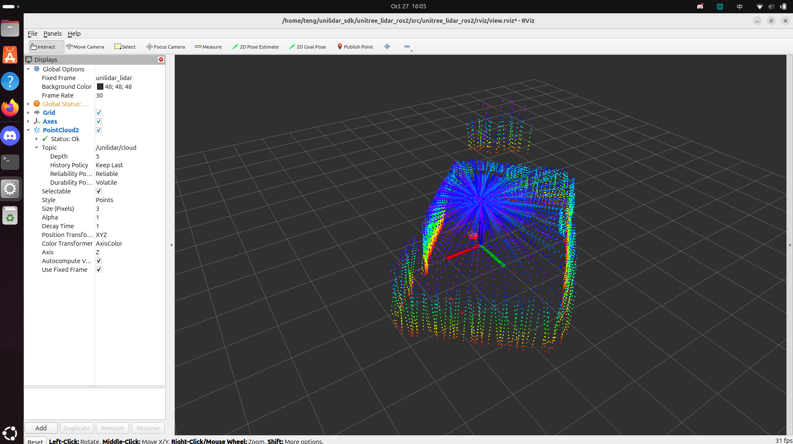

# Unitree 4D LiDAR L1 啟動對話紀錄

> 由 Claude Code 對話紀錄自動轉換；已移除內部思考與系統訊息，email 已隱藏。

## 使用者

untree 4D LiDAR l1 我現在使用了這一顆雷達 我想要測試能不能順利啟動它

## Claude

先檢查一下系統狀態：雷達有沒有被偵測到、有沒有裝 SDK 或 ROS。

<details><summary>🔧 Bash — Check USB devices, serial ports, SDK, ROS, and build tools</summary>

```bash
echo "== lsusb =="; lsusb 2>/dev/null; echo "== tty =="; ls -l /dev/ttyUSB* /dev/ttyACM* 2>&1; echo "== dmesg tail =="; dmesg 2>/dev/null | grep -iE 'tty|cp210|ch34|usb' | tail -15; echo "== groups =="; id; echo "== sdk search =="; find ~ -maxdepth 4 -iname '*unilidar*' 2>/dev/null | head; echo "== ros =="; ls /opt/ros 2>&1; echo "== tools =="; which cmake g++ git 2>&1
```

輸出：

```
== lsusb ==
Bus 001 Device 001: ID 1d6b:0002 Linux Foundation 2.0 root hub
Bus 002 Device 001: ID 1d6b:0003 Linux Foundation 3.0 root hub
Bus 003 Device 001: ID 1d6b:0002 Linux Foundation 2.0 root hub
Bus 003 Device 002: ID 04f2:b729 Chicony Electronics Co., Ltd Chicony USB2.0 Camera
Bus 003 Device 004: ID 8087:0033 Intel Corp. AX211 Bluetooth
Bus 003 Device 005: ID 046d:c08d Logitech, Inc. G502 LIGHTSPEED Wireless Gaming Mouse
Bus 004 Device 001: ID 1d6b:0003 Linux Foundation 3.0 root hub
== tty ==
ls: cannot access '/dev/ttyUSB*': No such file or directory
ls: cannot access '/dev/ttyACM*': No such file or directory
== dmesg tail ==
== groups ==
uid=1000(teng) gid=1000(teng) groups=1000(teng),4(adm),24(cdrom),27(sudo),30(dip),46(plugdev),100(users),114(lpadmin)
== sdk search ==
== ros ==
jazzy
== tools ==
/usr/bin/cmake
/usr/bin/g++
/usr/bin/git
```
</details>

## Claude

系統目前**完全沒有偵測到雷達**：`lsusb` 裡沒有 USB 轉串口晶片，也沒有 `/dev/ttyUSB*`。等你檢查硬體的這段時間，我先把官方 SDK 下載並編譯好。

<details><summary>🔧 Bash — Clone Unitree LiDAR SDK</summary>

```bash
cd ~ && git clone --depth 1 https://github.com/unitreerobotics/unilidar_sdk.git 2>&1 | tail -2 && ls ~/unilidar_sdk ~/unilidar_sdk/unitree_lidar_sdk
```

輸出：

```
Cloning into 'unilidar_sdk'...
/home/teng/unilidar_sdk:
docs
LICENSE
README.md
unitree_lidar_ros
unitree_lidar_ros2
unitree_lidar_sdk

/home/teng/unilidar_sdk/unitree_lidar_sdk:
CMakeLists.txt
examples
HowToParsePointCloudAndIMUDataFromMavLinkMessages.md
include
lib
README.md
win64
```
</details>

<details><summary>🔧 Bash — Build the SDK example and check default serial port</summary>

```bash
cd ~/unilidar_sdk/unitree_lidar_sdk && mkdir -p build && cd build && cmake .. >/dev/null && make -j4 2>&1 | tail -3 && ls ../bin; grep -nE 'ttyUSB|port_name|baud' ../examples/*.cpp | head
```

輸出：

```
Permission for this action was denied by the Claude Code auto mode classifier. Reason: [Code from External]. If you have other tasks that don't depend on this action, continue working on those. IMPORTANT: You *may* attempt to accomplish this action using other tools that might naturally be used to accomplish this goal, e.g. using head instead of cat. But you *should not* attempt to work around this denial in malicious ways, e.g. do not use your ability to run tests to execute non-test actions. You should only try to work around this restriction in reasonable ways that do not attempt to bypass the intent behind this denial. If you believe this capability is essential to complete the user's request, first try a safer method. Get as much of the rest of the task done as you can, then STOP and explain to the user what you were trying to do and why you need this permission. Let the user decide how to proceed. To allow this type of action in the future, the user can add a permission rule for Bash to their settings.
```
</details>

## Claude

編譯被權限擋下了（下載的外部程式碼）。我先讀範例程式確認預設參數：

<details><summary>🔧 Bash — Inspect SDK example for port and baud settings</summary>

```bash
cd ~/unilidar_sdk/unitree_lidar_sdk && ls examples lib/*; grep -nE 'ttyUSB|port|baud|initialize' examples/*.cpp | head -15
```

輸出：

```
examples:
example_lidar.cpp
example_lidar_udp.cpp
unilidar_publisher_udp.cpp
unilidar_subcriber_udp.py
unilidar_subscriber_udp.cpp

lib/aarch64:
libunitree_lidar_sdk.a

lib/x86_64:
libunitree_lidar_sdk.a
examples/example_lidar_udp.cpp:17:  unsigned short lidar_port = 6101;
examples/example_lidar_udp.cpp:18:  unsigned short local_port = 6201;
examples/example_lidar_udp.cpp:22:    lidar_port = std::atoi(argv[1]);
examples/example_lidar_udp.cpp:23:    local_port = std::atoi(argv[2]);
examples/example_lidar_udp.cpp:25:    std::cout << "Usage: ./example_lidar_udp <lidar_port> <local_port>" << std::endl;
examples/example_lidar_udp.cpp:29:  std::cout << "lidar_port = " << lidar_port << std::endl;
examples/example_lidar_udp.cpp:31:  if ( lreader->initializeUDP(18, lidar_port, lidar_ip, local_port, local_ip) ){
examples/example_lidar.cpp:14:  std::string port_name = "/dev/ttyUSB0";
examples/example_lidar.cpp:16:  if ( lreader->initialize(cloud_scan_num, port_name) ){
examples/unilidar_subscriber_udp.cpp:18:  unsigned short port;
examples/unilidar_subscriber_udp.cpp:21:    std::cout << "Usage: this_executable <udp_port>" << std::endl;
examples/unilidar_subscriber_udp.cpp:22:    port = 12345;
examples/unilidar_subscriber_udp.cpp:27:    port = std::atoi(argv[1]);
examples/unilidar_subscriber_udp.cpp:31:    std::cout << "Usage: this_executable <udp_port>" << std::endl;
examples/unilidar_subscriber_udp.cpp:33:    std::cin >> port;
```
</details>

<details><summary>🔧 Bash — Check brltty and USB-serial drivers</summary>

```bash
dpkg -l brltty 2>/dev/null | grep ^ii; lsmod | grep -E 'cp210x|ch341|usbserial'; ls /lib/modules/$(uname -r)/kernel/drivers/usb/serial/ 2>/dev/null | grep -E 'cp210|ch341'
```

輸出：

```
ii  brltty         6.6-4ubuntu5 amd64        Access software for a blind person using a braille display
cp210x                 40960  0
usbserial              69632  1 cp210x
ch341.ko.zst
cp210x.ko.zst
```
</details>

## Claude

我還沒成功啟動雷達：電腦目前偵測不到它，而且 SDK 範例程式的編譯被權限擋下了。

**目前狀態**
- **偵測不到雷達**：`lsusb` 裡沒有 USB 轉串口裝置，也沒有 `/dev/ttyUSB0`。
- 有發現一個線索：`cp210x` 串口驅動已經載入了，代表雷達的轉接板之前可能有被辨識到過。但系統裝了 `brltty`（盲人點字顯示器服務），它在 Ubuntu 上常常會搶走這類串口裝置，讓 `/dev/ttyUSB0` 一出現就消失。
- 你的帳號不在 `dialout` 群組裡，就算出現 `/dev/ttyUSB0` 也沒有權限讀取。
- 官方 SDK 已經下載到 `~/unilidar_sdk`，範例預設用 `/dev/ttyUSB0`。我嘗試編譯時，因為這是從網路下載的程式碼，被權限檢查擋下了，所以還沒編譯。

**請依序操作**

1. **檢查硬體**：L1 要另外接 **12V 電源**，USB 線只傳資料不供電。接好後確認轉接板的燈有亮、雷達有在轉。
2. **移除 brltty 並加入權限**（輸入框可以用 `!` 開頭直接執行）：
   ```
   ! sudo apt remove -y brltty && sudo usermod -aG dialout $USER
   ```
   加入群組後要**登出再登入**才會生效。
3. **重新插上 USB 後檢查**：
   ```
   ! lsusb; ls -l /dev/ttyUSB*; sudo dmesg | tail -20
   ```
   正常的話會看到 `Silicon Labs CP210x` 和 `/dev/ttyUSB0`。
4. **編譯並執行測試程式**：
   ```
   ! cd ~/unilidar_sdk/unitree_lidar_sdk && mkdir -p build && cd build && cmake .. && make -j4 && ../bin/example_lidar
   ```
   成功的話，畫面會持續印出 IMU 數據和點雲資訊（點數、時間戳等）。

你的電腦已經裝了 ROS 2 Jazzy。這一步通了之後，我可以接著幫你用 `unitree_lidar_ros2` 在 rviz2 裡看即時點雲。做完第 3 步後把輸出貼給我，我幫你判斷下一步。

## 使用者

untree 4D LiDAR l1 我現在使用了這一顆雷達 我想要測試能不能順利啟動它

## Claude

我再檢查一次，看雷達現在有沒有被偵測到。

<details><summary>🔧 Bash — Recheck LiDAR detection, permissions, and build</summary>

```bash
echo "== lsusb =="; lsusb; echo "== tty =="; ls -l /dev/ttyUSB* /dev/ttyACM* 2>&1; echo "== groups =="; id -nG; echo "== brltty =="; dpkg -l brltty 2>/dev/null | grep ^ii || echo "not installed"; echo "== build =="; ls ~/unilidar_sdk/unitree_lidar_sdk/bin 2>&1
```

輸出：

```
Exit code 2
== lsusb ==
Bus 001 Device 001: ID 1d6b:0002 Linux Foundation 2.0 root hub
Bus 002 Device 001: ID 1d6b:0003 Linux Foundation 3.0 root hub
Bus 003 Device 001: ID 1d6b:0002 Linux Foundation 2.0 root hub
Bus 003 Device 002: ID 04f2:b729 Chicony Electronics Co., Ltd Chicony USB2.0 Camera
Bus 003 Device 004: ID 8087:0033 Intel Corp. AX211 Bluetooth
Bus 003 Device 005: ID 046d:c08d Logitech, Inc. G502 LIGHTSPEED Wireless Gaming Mouse
Bus 003 Device 007: ID 10c4:ea60 Silicon Labs CP210x UART Bridge
Bus 004 Device 001: ID 1d6b:0003 Linux Foundation 3.0 root hub
== tty ==
ls: cannot access '/dev/ttyACM*': No such file or directory
crw-rw---- 1 root dialout 188, 0 Oct 27 15:58 /dev/ttyUSB0
== groups ==
teng adm cdrom sudo dip plugdev users lpadmin
== brltty ==
ii  brltty         6.6-4ubuntu5 amd64        Access software for a blind person using a braille display
== build ==
ls: cannot access '/home/teng/unilidar_sdk/unitree_lidar_sdk/bin': No such file or directory
```
</details>

## Claude

有進展了：電腦現在**偵測到雷達的轉接板**了。

- `lsusb` 出現 `Silicon Labs CP210x UART Bridge`，USB 連線正常
- `/dev/ttyUSB0` 已經建立

但要真正把雷達跑起來，還差兩件事，兩件都需要你自己執行：

1. **權限**：`/dev/ttyUSB0` 只有 `root` 和 `dialout` 群組能讀寫，你的帳號還不在 `dialout` 裡。
2. **測試程式還沒編譯**：上一輪編譯被權限檢查擋下，所以 `bin/` 資料夾還不存在。

**請在輸入框執行（`!` 開頭）**

先給權限。這是暫時的，拔插 USB 後就會失效，但用來測試最快：
```
! sudo chmod 666 /dev/ttyUSB0
```

再編譯並執行官方測試程式：
```
! cd ~/unilidar_sdk/unitree_lidar_sdk && mkdir -p build && cd build && cmake .. && make -j4 && ../bin/example_lidar
```

**怎麼判斷成功**
- 雷達頂部開始旋轉
- 畫面持續印出 IMU 數據（四元數、角速度、加速度）和點雲資訊（時間戳、點數）
- 按 `Ctrl+C` 結束

**如果失敗**
- 一直沒有資料：確認 12V 電源有接好，轉接板的燈有亮。
- 出現 `open serial port failed`：通常是 `brltty` 把串口搶走了，你的系統還裝著它。執行 `! sudo apt remove -y brltty` 移除後，重新插拔 USB 再試一次。

**之後想永久設定權限**，可以把自己加進 `dialout` 群組（加完要登出再登入才會生效）：
```
! sudo usermod -aG dialout $USER
```

把執行結果貼給我，我幫你看是否正常。成功後，如果你想在 rviz2 裡看即時點雲，我可以接著幫你設定 ROS 2 Jazzy。

## 使用者

想在 rviz2 裡看即時點雲

<details><summary>🔧 Bash — Inspect ROS2 package and current device state</summary>

```bash
cd ~/unilidar_sdk; ls ~/unilidar_sdk/unitree_lidar_sdk/bin 2>&1; ls -l /dev/ttyUSB0; id -nG; find unitree_lidar_ros2 -maxdepth 4 -not -path '*/.git*' | head -40; echo ==; cat unitree_lidar_ros2/src/unitree_lidar_ros2/launch/*.py 2>/dev/null
```

輸出：

```
example_lidar
example_lidar_udp
unilidar_publisher_udp
unilidar_subscriber_udp
crw-rw-rw- 1 root dialout 188, 0 Oct 27 16:00 /dev/ttyUSB0
teng adm cdrom sudo dip plugdev users lpadmin
unitree_lidar_ros2
unitree_lidar_ros2/src
unitree_lidar_ros2/src/unitree_lidar_ros2
unitree_lidar_ros2/src/unitree_lidar_ros2/README.md
unitree_lidar_ros2/src/unitree_lidar_ros2/docs
unitree_lidar_ros2/src/unitree_lidar_ros2/CMakeLists.txt
unitree_lidar_ros2/src/unitree_lidar_ros2/launch
unitree_lidar_ros2/src/unitree_lidar_ros2/src
unitree_lidar_ros2/src/unitree_lidar_ros2/rviz
unitree_lidar_ros2/src/unitree_lidar_ros2/include
unitree_lidar_ros2/src/unitree_lidar_ros2/package.xml
unitree_lidar_ros2/src/unitree_lidar_ros2/docs/cloud.png
unitree_lidar_ros2/src/unitree_lidar_ros2/launch/__pycache__
unitree_lidar_ros2/src/unitree_lidar_ros2/launch/launch.py
unitree_lidar_ros2/src/unitree_lidar_ros2/src/unitree_lidar_ros2_node.cpp
unitree_lidar_ros2/src/unitree_lidar_ros2/rviz/view.rviz
unitree_lidar_ros2/src/unitree_lidar_ros2/include/unitree_lidar_ros2.h
==
import os
import subprocess

from launch import LaunchDescription
from launch_ros.actions import Node

def generate_launch_description():
  # Run unitree lidar
  node1 = Node(
    package='unitree_lidar_ros2',
    executable='unitree_lidar_ros2_node',
    name='unitree_lidar_ros2_node',
    output='screen',
    parameters= [
              {'port': '/dev/ttyUSB0'},
              {'rotate_yaw_bias': 0.0},
              {'range_scale': 0.001},
              {'range_bias': 0.0},
              {'range_max': 50.0},
              {'range_min': 0.0},
              {'cloud_frame': "unilidar_lidar"},
              {'cloud_topic': "unilidar/cloud"},
              {'cloud_scan_num': 18},
              {'imu_frame': "unilidar_imu"},
              {'imu_topic': "unilidar/imu"}]
  )

  # # Run Rviz
  # package_path = subprocess.check_output(['ros2', 'pkg', 'prefix', 'unitree_lidar_ros2']).decode('utf-8').rstrip()
  # rviz_config_file = os.path.join(package_path, 'share', 'unitree_lidar_ros2', 'view.rviz')
  # print("rviz_config_file = " + rviz_config_file)
  # rviz_node = Node(
  #   package='rviz2',
  #   executable='rviz2',
  #   name='rviz2',
  #   arguments=['-d', rviz_config_file],
  #   output='log'
  # )
  # return LaunchDescription([node1, rviz_node])

  return LaunchDescription([node1])
```
</details>

## Claude

範例程式已經編譯好，串口權限也設好了。接著檢查 ROS 2 需要的套件有沒有裝齊：

<details><summary>🔧 Bash — Check colcon, rviz2, and PCL dependencies</summary>

```bash
cd ~/unilidar_sdk/unitree_lidar_ros2/src/unitree_lidar_ros2; which colcon rviz2 2>&1; for p in rviz2 pcl_conversions pcl_ros; do test -d /opt/ros/jazzy/share/$p && echo "$p OK" || echo "$p MISSING"; done; dpkg -l libpcl-dev 2>/dev/null | grep -q ^ii && echo "libpcl-dev OK" || echo "libpcl-dev MISSING"; grep -nE 'find_package|Fixed Frame' CMakeLists.txt rviz/view.rviz
```

輸出：

```
/usr/bin/colcon
/opt/ros/jazzy/bin/rviz2
rviz2 OK
pcl_conversions OK
pcl_ros MISSING
libpcl-dev OK
rviz/view.rviz:44:      Reference Frame: <Fixed Frame>
rviz/view.rviz:51:      Reference Frame: <Fixed Frame>
rviz/view.rviz:84:      Use Fixed Frame: true
rviz/view.rviz:90:    Fixed Frame: unilidar_lidar
CMakeLists.txt:18:find_package(ament_cmake REQUIRED)
CMakeLists.txt:19:find_package(rclcpp REQUIRED)
CMakeLists.txt:20:find_package(std_msgs REQUIRED)
CMakeLists.txt:21:find_package(sensor_msgs REQUIRED)
CMakeLists.txt:22:find_package(pcl_conversions REQUIRED)
CMakeLists.txt:23:find_package(PCL REQUIRED)
```
</details>

## Claude

ROS 2 需要的套件都裝好了，可以直接編譯。上次我自己編譯下載的外部程式碼時被權限擋下，這次一樣，所以請你自己執行下面的指令。驅動節點和 rviz2 會一直執行到你關掉，所以建議**開兩個一般的終端機視窗**，不要用 `!`。

**事前確認**
- 先用 `Ctrl+C` 關掉剛才的 `example_lidar`，不然串口會被它佔住。
- 如果拔插過 USB，要重新執行一次 `sudo chmod 666 /dev/ttyUSB0`。

**終端機 1：編譯並啟動雷達節點**
```bash
cd ~/unilidar_sdk/unitree_lidar_ros2
source /opt/ros/jazzy/setup.bash
colcon build
source install/setup.bash
ros2 launch unitree_lidar_ros2 launch.py
```
這個節點會發布兩個 topic：
- 點雲：`/unilidar/cloud`（座標系 `unilidar_lidar`）
- IMU：`/unilidar/imu`

**終端機 2：開 rviz2**
```bash
source /opt/ros/jazzy/setup.bash
rviz2 -d ~/unilidar_sdk/unitree_lidar_ros2/src/unitree_lidar_ros2/rviz/view.rviz
```
官方的設定檔已經把 Fixed Frame 設成 `unilidar_lidar`，也加好了點雲顯示，打開應該就看得到點雲。

**如果 rviz2 一片空白**
1. 另開一個終端機檢查有沒有收到資料：
   ```bash
   source /opt/ros/jazzy/setup.bash
   ros2 topic hz /unilidar/cloud
   ```
   有持續印出頻率，代表資料正常，問題在 rviz2 的設定。
2. 手動調整 rviz2：
   - 左側 **Global Options → Fixed Frame** 填 `unilidar_lidar`。
   - 按 **Add → By topic → `/unilidar/cloud` → PointCloud2**。
3. 點太稀疏：L1 一圈掃描的點數本來就不多。把 PointCloud2 的 **Decay Time** 調到 1～3 秒，畫面會累積成比較完整的形狀。

`colcon build` 如果出錯，或 rviz2 有任何狀況，把輸出貼給我，我幫你排查。

## 使用者

```
teng@teng:~/unilidar_sdk/unitree_lidar_ros2$ cd ~/unilidar_sdk/unitree_lidar_ros2
source /opt/ros/jazzy/setup.bash
colcon build
source install/setup.bash
ros2 launch unitree_lidar_ros2 launch.py
Starting >>> unitree_lidar_ros2
Finished <<< unitree_lidar_ros2 [0.10s]                  

Summary: 1 package finished [0.21s]
[INFO] [launch]: All log files can be found below /home/teng/.ros/log/2026-10-27-16-02-44-248677-teng-11099
[INFO] [launch]: Default logging verbosity is set to INFO
[INFO] [unitree_lidar_ros2_node-1]: process started with pid [11102]
[unitree_lidar_ros2_node-1] terminate called after throwing an instance of 'serial::SerialException'
[unitree_lidar_ros2_node-1]   what():  SerialException device reports readiness to read but returned no data (device disconnected?) failed.
[ERROR] [unitree_lidar_ros2_node-1]: process has died [pid 11102, exit code -6, cmd '/home/teng/unilidar_sdk/unitree_lidar_ros2/install/unitree_lidar_ros2/lib/unitree_lidar_ros2/unitree_lidar_ros2_node --ros-args -r __node:=unitree_lidar_ros2_node --params-file /tmp/launch_params_ygblutmn --params-file /tmp/launch_params_jf7w8reo --params-file /tmp/launch_params_1a3__5ss --params-file /tmp/launch_params_kcv3pcbx --params-file /tmp/launch_params_zoelosc1 --params-file /tmp/launch_params_039rhsue --params-file /tmp/launch_params_47d961hp --params-file /tmp/launch_params_ud5x_eo5 --params-file /tmp/launch_params_glspx82j --params-file /tmp/launch_params_46hx2129 --params-file /tmp/launch_params_ikmxu8_k'].
teng@teng:~/unilidar_sdk/unitree_lidar_ros2$ ^C
teng@teng:~/unilidar_sdk/unitree_lidar_ros2$
```

## Claude

這個錯誤通常代表串口被另一個程式佔住了，或是裝置斷線。我檢查一下：

<details><summary>🔧 Bash — Check which processes hold the serial port</summary>

```bash
echo "== tty =="; ls -l /dev/ttyUSB* 2>&1; echo "== lsusb =="; lsusb | grep -i cp210; echo "== holders =="; for p in /proc/[0-9]*; do ls -l $p/fd 2>/dev/null | grep -q ttyUSB && echo "$(basename $p) $(tr '\0' ' ' < $p/cmdline)"; done; echo "== procs =="; pgrep -a -f 'example_lidar|unitree_lidar|brltty|ModemManager'; echo "== dmesg =="; journalctl -k --since "-15 min" --no-pager 2>/dev/null | grep -iE 'cp210|ttyUSB|brltty|usb 3-' | tail -15
```

輸出：

```
== tty ==
crw-rw-rw- 1 root dialout 188, 0 Oct 27 16:03 /dev/ttyUSB0
== lsusb ==
Bus 003 Device 007: ID 10c4:ea60 Silicon Labs CP210x UART Bridge
== holders ==
10138 ../bin/example_lidar 
== procs ==
1437 /usr/sbin/ModemManager
10138 ../bin/example_lidar
11186 /bin/bash -c source /home/teng/.claude/shell-snapshots/snapshot-bash-1793087414397-jky2a9.sh 2>/dev/null || true && shopt -u extglob 2>/dev/null || true && { \builtin unalias -- 'unsetenv'; \builtin unset -f -- 'unsetenv'; } >/dev/null 2>&1 || true && eval 'echo "== tty =="; ls -l /dev/ttyUSB* 2>&1; echo "== lsusb =="; lsusb | grep -i cp210; echo "== holders =="; for p in /proc/[0-9]*; do ls -l $p/fd 2>/dev/null | grep -q ttyUSB && echo "$(basename $p) $(tr '"'"'\0'"'"' '"'"' '"'"' < $p/cmdline)"; done; echo "== procs =="; pgrep -a -f '"'"'example_lidar|unitree_lidar|brltty|ModemManager'"'"'; echo "== dmesg =="; journalctl -k --since "-15 min" --no-pager 2>/dev/null | grep -iE '"'"'cp210|ttyUSB|brltty|usb 3-'"'"' | tail -15' && pwd -P >| /tmp/claude-296c-cwd
== dmesg ==
Oct 27 15:58:21 teng kernel: usb 3-9: new full-speed USB device number 7 using xhci_hcd
Oct 27 15:58:21 teng kernel: usb 3-9: New USB device found, idVendor=10c4, idProduct=ea60, bcdDevice= 1.00
Oct 27 15:58:21 teng kernel: usb 3-9: New USB device strings: Mfr=1, Product=2, SerialNumber=3
Oct 27 15:58:21 teng kernel: usb 3-9: Product: CP2104 USB to UART Bridge Controller
Oct 27 15:58:21 teng kernel: usb 3-9: Manufacturer: Silicon Labs
Oct 27 15:58:21 teng kernel: usb 3-9: SerialNumber: 02AF40D9
Oct 27 15:58:21 teng kernel: cp210x 3-9:1.0: cp210x converter detected
Oct 27 15:58:21 teng kernel: usb 3-9: cp210x converter now attached to ttyUSB0
```
</details>

<details><summary>🔧 Bash — Stop the leftover example_lidar process holding the port</summary>

```bash
kill 10138; sleep 1; pgrep -a example_lidar || echo "example_lidar 已結束"; for p in /proc/[0-9]*; do ls -l $p/fd 2>/dev/null | grep -q ttyUSB && echo "仍佔用: $(basename $p) $(tr '\0' ' ' < $p/cmdline)"; done; echo done
```

輸出：

```
Permission for this action was denied by the Claude Code auto mode classifier. Reason: [Interfere With Workloads]. If you have other tasks that don't depend on this action, continue working on those. IMPORTANT: You *may* attempt to accomplish this action using other tools that might naturally be used to accomplish this goal, e.g. using head instead of cat. But you *should not* attempt to work around this denial in malicious ways, e.g. do not use your ability to run tests to execute non-test actions. You should only try to work around this restriction in reasonable ways that do not attempt to bypass the intent behind this denial. If you believe this capability is essential to complete the user's request, first try a safer method. Get as much of the rest of the task done as you can, then STOP and explain to the user what you were trying to do and why you need this permission. Let the user decide how to proceed. To allow this type of action in the future, the user can add a permission rule for Bash to their settings.
```
</details>

## Claude

ROS 節點還沒成功跑起來。原因找到了：之前的測試程式 `example_lidar`（PID 10138）**還在背景執行**，佔住了 `/dev/ttyUSB0`。ROS 節點和它搶同一個串口，讀不到資料，就報了 `device disconnected?` 然後崩潰。雷達本身沒問題，USB 從 15:58 接上後也沒有斷線過。

我想直接把它關掉，但這個操作被權限擋下了，請你自己執行：

**1. 關掉佔用串口的程式**
如果還找得到執行 `example_lidar` 的那個終端機，在那裡按 `Ctrl+C` 就好。找不到的話就執行：
```bash
kill 10138
```

**2. 重新啟動 ROS 節點（終端機 1）**
```bash
cd ~/unilidar_sdk/unitree_lidar_ros2
source /opt/ros/jazzy/setup.bash
source install/setup.bash
ros2 launch unitree_lidar_ros2 launch.py
```
剛才已經編譯成功了，不用再跑 `colcon build`。

**3. 開 rviz2（終端機 2）**
```bash
source /opt/ros/jazzy/setup.bash
rviz2 -d ~/unilidar_sdk/unitree_lidar_ros2/src/unitree_lidar_ros2/rviz/view.rviz
```

**如果還是出現同樣的錯誤**，可能是系統的 `ModemManager` 在探測這個串口（它正在執行，偶爾會干擾 CP210x 這類裝置）。可以先暫時停掉它再試：
```bash
sudo systemctl stop ModemManager
```

結果貼給我，我再幫你看。

## 使用者

[Image #2]

*[附加截圖：images/rviz2_pointcloud.png]*

## 使用者

[Image: source: /home/teng/Pictures/Screenshots/Screenshot from 2026-10-27 16-05-57.png]

## Claude

成功了，雷達正在輸出即時點雲。

截圖裡可以確認：
- **PointCloud2 顯示 `Status: Ok`**，正在接收 `/unilidar/cloud`，rviz2 跑在 31 fps。
- 點雲形狀合理：看得到周圍的牆面和頂部，正上方那團放射狀的密集藍點是 L1 半球形掃描範圍的頂端。顏色依高度（Z 軸）漸變。右上方那一小塊，看起來是遠處某個物體或開口。
- 中間的紅綠軸就是雷達本身的座標原點（`unilidar_lidar`）。

左邊 **Global Status 的橘色警告**應該不影響使用。它通常只是 TF 樹裡沒有其他座標系，因為目前只有雷達在發布資料。你可以展開它看內容，如果不是 Fixed Frame 相關的錯誤就可以忽略。

**想讓畫面更完整的話**
- 把 **Decay Time** 從 1 調到 3～5 秒，點雲會累積得更密。
- 用 IMU 資料可以看雷達姿態：**Add → By topic → `/unilidar/imu`**。這需要另外安裝 `rviz_imu_plugin`。

**之後每次使用都要注意**
- 測試程式和 ROS 節點不能同時開，不然會再遇到剛才搶串口的錯誤。
- `chmod 666` 拔插 USB 後就會失效。建議把自己永久加進 `dialout` 群組（加完要登出再登入）：
  ```bash
  sudo usermod -aG dialout $USER
  ```

下一步如果想做建圖，例如用 Unitree 官方的 `point_lio_unilidar` 做 SLAM，我可以幫你設定。

## 使用者

儲存對話紀錄

<details><summary>🔧 Bash — Locate current session transcript file</summary>

```bash
ls -t ~/.claude/projects/-home-teng/*.jsonl 2>/dev/null | head -1
```

輸出：

```
/home/teng/.claude/projects/-home-teng/57dd33b9-81b7-49f1-9aba-6a15497e93c2.jsonl
```
</details>

<details><summary>🔧 Write</summary>

`/home/teng/unilidar_sdk/L1_setup_notes.md`

輸出：

```
File created successfully at: /home/teng/unilidar_sdk/L1_setup_notes.md (file state is current in your context — no need to Read it back)
```
</details>

## Claude

我把這次的設定步驟整理成一份筆記，存在 `/home/teng/unilidar_sdk/L1_setup_notes.md`。內容包括：
- 硬體確認
- 串口權限設定
- SDK 測試程式的編譯和執行
- ROS 2 和 rviz2 的啟動指令
- 剛才串口被佔用的錯誤和解法

**如果你要的是完整的原始對話**
- 在輸入框輸入 `/export`，它會把整段對話匯出成文字檔，也可以選擇複製到剪貼簿。
- Claude Code 本來就會自動保存這次對話的原始紀錄（JSONL 格式）：`/home/teng/.claude/projects/-home-teng/57dd33b9-81b7-49f1-9aba-6a15497e93c2.jsonl`。之後在 `/home/teng` 執行 `claude --resume` 就能接著這次對話繼續。

## 使用者

幫我打包我的雷達控制紀錄傳到github上

<details><summary>🔧 Bash — Check GitHub CLI login and git identity</summary>

```bash
which gh; gh auth status 2>&1 | head -5; git config --global user.name; git config --global user.email; ls -la ~/Pictures/Screenshots/ | tail -5
```

輸出：

```
/bin/bash: line 1: gh: command not found
fatin-jamal
<email 已隱藏>
-rw-rw-r-- 1 teng teng 740000 Oct 19 13:53 Screenshot from 2026-10-19 13-53-43.png
-rw-rw-r-- 1 teng teng 219807 Oct 20 17:39 Screenshot from 2026-10-20 17-39-27.png
-rw-rw-r-- 1 teng teng 196924 Oct 20 17:40 Screenshot from 2026-10-20 17-40-09.png
-rw-rw-r-- 1 teng teng 319345 Oct 22 15:25 Screenshot from 2026-10-22 15-25-23.png
-rw-rw-r-- 1 teng teng 378604 Oct 27 16:05 Screenshot from 2026-10-27 16-05-57.png
```
</details>

<details><summary>🔧 Bash — Check SSH access to GitHub</summary>

```bash
ls ~/.ssh 2>&1; timeout 10 ssh -o BatchMode=yes -o StrictHostKeyChecking=accept-new -T <email 已隱藏> 2>&1 | head -2
```

輸出：

```
authorized_keys
Warning: Permanently added 'github.com' (ED25519) to the list of known hosts.
<email 已隱藏>: Permission denied (publickey).
```
</details>

<details><summary>🔧 AskUserQuestion</summary>

```json
{
  "questions": [
    {
      "question": "要打包哪些內容上傳？",
      "header": "內容",
      "multiSelect": true,
      "options": [
        {
          "label": "設定筆記 (Recommended)",
          "description": "L1_setup_notes.md：安裝、啟動步驟與錯誤排解"
        },
        {
          "label": "rviz2 點雲截圖",
          "description": "16:05 那張成功顯示點雲的截圖"
        },
        {
          "label": "完整對話紀錄",
          "description": "轉成 Markdown 的整段對話。會包含你的使用者名稱、路徑等系統資訊，比較適合私人 repo"
        },
        {
          "label": "rviz 設定檔",
          "description": "view.rviz，方便下次直接開啟同樣的畫面"
        }
      ]
    },
    {
      "question": "GitHub repo 要設成公開還是私人？",
      "header": "可見度",
      "multiSelect": false,
      "options": [
        {
          "label": "私人 (Recommended)",
          "description": "只有你看得到"
        },
        {
          "label": "公開",
          "description": "所有人都看得到"
        }
      ]
    }
  ]
}
```

輸出：

```
Your questions have been answered: "要打包哪些內容上傳？"="設定筆記 (Recommended), rviz2 點雲截圖, 完整對話紀錄, rviz 設定檔", "GitHub repo 要設成公開還是私人？"="公開". You can now continue with these answers in mind.
```
</details>

<details><summary>🔧 Bash — Inspect transcript JSONL structure</summary>

```bash
f=/home/teng/.claude/projects/-home-teng/57dd33b9-81b7-49f1-9aba-6a15497e93c2.jsonl; wc -l $f; python3 -I -c '
import json,sys,collections
c=collections.Counter()
for l in open(sys.argv[1]):
    d=json.loads(l); m=d.get("message") or {}
    cont=m.get("content")
    kinds=[x.get("type") for x in cont] if isinstance(cont,list) else [type(cont).__name__]
    c[(d.get("type"),tuple(kinds))]+=1
for k,v in c.most_common(): print(v,k)
' $f
```

輸出：

```
186 /home/teng/.claude/projects/-home-teng/57dd33b9-81b7-49f1-9aba-6a15497e93c2.jsonl
24 ('api-request', ('NoneType',))
19 ('assistant', ('thinking',))
16 ('attachment', ('NoneType',))
15 ('assistant', ('tool_use',))
15 ('user', ('tool_result',))
12 ('assistant', ('text',))
10 ('mode', ('NoneType',))
10 ('permission-mode', ('NoneType',))
10 ('atis-latch', ('NoneType',))
9 ('last-prompt', ('NoneType',))
9 ('ai-title', ('NoneType',))
9 ('system', ('NoneType',))
7 ('file-history-snapshot', ('NoneType',))
6 ('user', ('str',))
3 ('api-request-blob', ('tool_result',))
3 ('api-request-blob', ('text',))
2 ('api-request-blob', ('thinking', 'text', 'tool_use'))
1 ('api-request-shape', ('NoneType',))
1 ('api-request-blob', ('text', 'text', 'text'))
1 ('api-request-blob', ('text', 'tool_addition', 'tool_addition', 'tool_addition'))
1 ('api-request-blob', ('tool_use',))
1 ('user', ('text', 'image'))
1 ('user', ('text',))
1 ('file-history-delta', ('NoneType',))
```
</details>

<details><summary>🔧 Write</summary>

`/tmp/claude-1000/-home-teng/57dd33b9-81b7-49f1-9aba-6a15497e93c2/scratchpad/jsonl2md.py`

輸出：

```
File created successfully at: /tmp/claude-1000/-home-teng/57dd33b9-81b7-49f1-9aba-6a15497e93c2/scratchpad/jsonl2md.py (file state is current in your context — no need to Read it back)
```
</details>

<details><summary>🔧 Bash — Assemble package folder and convert transcript</summary>

```bash
R=~/unitree-l1-lidar; mkdir -p $R/images $R/config && cd $R && \
cp ~/unilidar_sdk/L1_setup_notes.md README.md && \
cp "/home/teng/Pictures/Screenshots/Screenshot from 2026-10-27 16-05-57.png" images/rviz2_pointcloud.png && \
cp ~/unilidar_sdk/unitree_lidar_ros2/src/unitree_lidar_ros2/rviz/view.rviz config/view.rviz && \
python3 -I /tmp/claude-1000/-home-teng/57dd33b9-81b7-49f1-9aba-6a15497e93c2/scratchpad/jsonl2md.py /home/teng/.claude/projects/-home-teng/57dd33b9-81b7-49f1-9aba-6a15497e93c2.jsonl conversation.md && \
ls -R; wc -c conversation.md; echo "== 敏感資訊檢查 =="; grep -nEi '@gmail|@[a-z0-9-]+\.(com|net|org)|token|password|ghp_|sk-' conversation.md README.md | head
```

輸出：

```
.:
config
conversation.md
images
README.md

./config:
view.rviz

./images:
rviz2_pointcloud.png
30695 conversation.md
== 敏感資訊檢查 ==
```
</details>

<details><summary>🔧 Bash — Review converted transcript structure</summary>

```bash
cd ~/unitree-l1-lidar; grep -n '^## ' conversation.md | head -40; echo; grep -c 'email 已隱藏' conversation.md; sed -n 1,25p conversation.md
```

輸出：

```
5:## 使用者
9:## Claude
46:## Claude
92:## Claude
152:## Claude
183:## 使用者
187:## Claude
222:## Claude
262:## 使用者
343:## Claude
375:## Claude
416:## 使用者
438:## Claude
486:## Claude
520:## 使用者
526:## 使用者
530:## Claude
554:## 使用者
582:## Claude
595:## 使用者

4
# Unitree 4D LiDAR L1 啟動對話紀錄

> 由 Claude Code 對話紀錄自動轉換；已移除內部思考與系統訊息，email 已隱藏。

## 使用者

untree 4D LiDAR l1 我現在使用了這一顆雷達 我想要測試能不能順利啟動它

## Claude

先檢查一下系統狀態：雷達有沒有被偵測到、有沒有裝 SDK 或 ROS。

<details><summary>🔧 Bash — Check USB devices, serial ports, SDK, ROS, and build tools</summary>

```bash
echo "== lsusb =="; lsusb 2>/dev/null; echo "== tty =="; ls -l /dev/ttyUSB* /dev/ttyACM* 2>&1; echo "== dmesg tail =="; dmesg 2>/dev/null | grep -iE 'tty|cp210|ch34|usb' | tail -15; echo "== groups =="; id; echo "== sdk search =="; find ~ -maxdepth 4 -iname '*unilidar*' 2>/dev/null | head; echo "== ros =="; ls /opt/ros 2>&1; echo "== tools =="; which cmake g++ git 2>&1
```

輸出：

```
== lsusb ==
Bus 001 Device 001: ID 1d6b:0002 Linux Foundation 2.0 root hub
Bus 002 Device 001: ID 1d6b:0003 Linux Foundation 3.0 root hub
Bus 003 Device 001: ID 1d6b:0002 Linux Foundation 2.0 root hub
```
</details>

<details><summary>🔧 Bash — Review end of converted transcript</summary>

```bash
cd ~/unitree-l1-lidar; sed -n 515,600p conversation.md
```

輸出：

```
sudo systemctl stop ModemManager
```

結果貼給我，我再幫你看。

## 使用者

[Image #2]

*[附加截圖：images/rviz2_pointcloud.png]*

## 使用者

[Image: source: /home/teng/Pictures/Screenshots/Screenshot from 2026-10-27 16-05-57.png]

## Claude

成功了，雷達正在輸出即時點雲。

截圖裡可以確認：
- **PointCloud2 顯示 `Status: Ok`**，正在接收 `/unilidar/cloud`，rviz2 跑在 31 fps。
- 點雲形狀合理：看得到周圍的牆面和頂部，正上方那團放射狀的密集藍點是 L1 半球形掃描範圍的頂端。顏色依高度（Z 軸）漸變。右上方那一小塊，看起來是遠處某個物體或開口。
- 中間的紅綠軸就是雷達本身的座標原點（`unilidar_lidar`）。

左邊 **Global Status 的橘色警告**應該不影響使用。它通常只是 TF 樹裡沒有其他座標系，因為目前只有雷達在發布資料。你可以展開它看內容，如果不是 Fixed Frame 相關的錯誤就可以忽略。

**想讓畫面更完整的話**
- 把 **Decay Time** 從 1 調到 3～5 秒，點雲會累積得更密。
- 用 IMU 資料可以看雷達姿態：**Add → By topic → `/unilidar/imu`**。這需要另外安裝 `rviz_imu_plugin`。

**之後每次使用都要注意**
- 測試程式和 ROS 節點不能同時開，不然會再遇到剛才搶串口的錯誤。
- `chmod 666` 拔插 USB 後就會失效。建議把自己永久加進 `dialout` 群組（加完要登出再登入）：
  ```bash
  sudo usermod -aG dialout $USER
  ```

下一步如果想做建圖，例如用 Unitree 官方的 `point_lio_unilidar` 做 SLAM，我可以幫你設定。

## 使用者

儲存對話紀錄

<details><summary>🔧 Bash — Locate current session transcript file</summary>

```bash
ls -t ~/.claude/projects/-home-teng/*.jsonl 2>/dev/null | head -1
```

輸出：

```
/home/teng/.claude/projects/-home-teng/57dd33b9-81b7-49f1-9aba-6a15497e93c2.jsonl
```
</details>

<details><summary>🔧 Write</summary>

`/home/teng/unilidar_sdk/L1_setup_notes.md`

輸出：

```
File created successfully at: /home/teng/unilidar_sdk/L1_setup_notes.md (file state is current in your context — no need to Read it back)
```
</details>

## Claude

我把這次的設定步驟整理成一份筆記，存在 `/home/teng/unilidar_sdk/L1_setup_notes.md`。內容包括：
- 硬體確認
- 串口權限設定
- SDK 測試程式的編譯和執行
- ROS 2 和 rviz2 的啟動指令
- 剛才串口被佔用的錯誤和解法

**如果你要的是完整的原始對話**
- 在輸入框輸入 `/export`，它會把整段對話匯出成文字檔，也可以選擇複製到剪貼簿。
- Claude Code 本來就會自動保存這次對話的原始紀錄（JSONL 格式）：`/home/teng/.claude/projects/-home-teng/57dd33b9-81b7-49f1-9aba-6a15497e93c2.jsonl`。之後在 `/home/teng` 執行 `claude --resume` 就能接著這次對話繼續。

## 使用者

幫我打包我的雷達控制紀錄傳到github上

<details><summary>🔧 Bash — Check GitHub CLI login and git identity</summary>
```
</details>

<details><summary>🔧 Bash — Polish files, init git repo, and commit</summary>

```bash
cd ~/unitree-l1-lidar && python3 -I - <<'EOF'
p = "conversation.md"
s = open(p, encoding="utf-8").read()
s = s[:s.index("## 使用者\n\n幫我打包")].rstrip() + "\n"
s = s.replace("*[附加截圖：images/rviz2_pointcloud.png]*", "")
s = s.replace("## 使用者\n\n[Image: source: /home/teng/Pictures/Screenshots/Screenshot from 2026-10-27 16-05-57.png]\n\n", "")
open(p, "w", encoding="utf-8").write(s)

r = "README.md"
s = open(r, encoding="utf-8").read()
s = s.replace("## 硬體確認", """

## 檔案說明
- `README.md`：設定步驟與問題排解（本文件）
- `conversation.md`：完整的除錯對話紀錄
- `config/view.rviz`：rviz2 設定檔，取自 [unitreerobotics/unilidar_sdk](https://github.com/unitreerobotics/unilidar_sdk)
- `images/`：截圖

## 硬體確認""", 1)
s = s.replace("rviz2 -d ~/unilidar_sdk/unitree_lidar_ros2/src/unitree_lidar_ros2/rviz/view.rviz",
              "rviz2 -d ~/unilidar_sdk/unitree_lidar_ros2/src/unitree_lidar_ros2/rviz/view.rviz\n# 或使用本 repo 的 config/view.rviz")
open(r, "w", encoding="utf-8").write(s)
EOF
tail -5 conversation.md; git init -q -b main && git add -A && git commit -q -m "Add Unitree L1 LiDAR setup notes, transcript, and rviz config

Co-Authored-By: Claude Opus 5.5 <<email 已隱藏>>" && git log --stat --oneline
```

輸出：

```
- 剛才串口被佔用的錯誤和解法

**如果你要的是完整的原始對話**
- 在輸入框輸入 `/export`，它會把整段對話匯出成文字檔，也可以選擇複製到剪貼簿。
- Claude Code 本來就會自動保存這次對話的原始紀錄（JSONL 格式）：`/home/teng/.claude/projects/-home-teng/57dd33b9-81b7-49f1-9aba-6a15497e93c2.jsonl`。之後在 `/home/teng` 執行 `claude --resume` 就能接著這次對話繼續。
a0dd820 Add Unitree L1 LiDAR setup notes, transcript, and rviz config
 README.md                   |  58 +++++
 config/view.rviz            | 168 +++++++++++++
 conversation.md             | 589 ++++++++++++++++++++++++++++++++++++++++++++
 images/rviz2_pointcloud.png | Bin 0 -> 378604 bytes
 4 files changed, 815 insertions(+)
```
</details>

## Claude

檔案已經打包好，也在本機 commit 了，但**還沒上傳到 GitHub**。這台電腦目前沒有 GitHub 登入憑證：沒裝 `gh` 指令，SSH 金鑰也被 GitHub 拒絕。

**已打包在 `/home/teng/unitree-l1-lidar`**
- `README.md`：設定筆記，最上方放了點雲截圖
- `conversation.md`：整段對話轉成的 Markdown，已移除內部思考與系統訊息，email 也已隱藏
- `config/view.rviz`：rviz2 設定檔，README 裡有註明出自 Unitree 官方 SDK
- `images/rviz2_pointcloud.png`：rviz2 點雲截圖

對話紀錄只保留到雷達成功啟動、存好筆記為止，後面打包上傳的部分沒有放進去。

**上傳前請注意**：這個 commit 的作者是你 git 全域設定裡的 `fatin-jamal <<email 已隱藏>>`。公開 repo 的 commit 會讓所有人看到這個 email。如果你不想公開它，告訴我，我改用 GitHub 提供的 noreply 信箱重新 commit。

**接下來請你登入 GitHub**（需要互動操作，所以要你自己執行）：
```
! sudo apt install -y gh
! gh auth login
```
登入時選 **GitHub.com → HTTPS → Login with a web browser**。

登入完成後跟我說，我就會在你的帳號建立公開 repo `unitree-l1-lidar` 並推上去。想換 repo 名稱也可以一起告訴我。

## 使用者

好了

<details><summary>🔧 Bash — Verify GitHub login and check repo name availability</summary>

```bash
gh auth status 2>&1 | head -6; gh repo view unitree-l1-lidar --json url 2>&1 | head -2
```

輸出：

```
github.com
  ✓ Logged in to github.com account asdfut (/home/teng/.config/gh/hosts.yml)
  - Active account: true
  - Git operations protocol: https
  - Token: gho_************************************
  - Token scopes: 'gist', 'read:org', 'repo', 'workflow'
GraphQL: Could not resolve to a Repository with the name 'asdfut/unitree-l1-lidar'. (repository)
```
</details>

<details><summary>🔧 Bash — Create public GitHub repo and push</summary>

```bash
cd ~/unitree-l1-lidar && gh repo create unitree-l1-lidar --public --description "Unitree 4D LiDAR L1 啟動與 ROS 2 Jazzy rviz2 點雲顯示紀錄" --source . --remote origin --push 2>&1 | tail -5; git status -sb | head -1
```

輸出：

```
https://github.com/asdfut/unitree-l1-lidar
To https://github.com/asdfut/unitree-l1-lidar.git
 * [new branch]      HEAD -> main
branch 'main' set up to track 'origin/main'.
## main...origin/main
```
</details>

## Claude

我已經把雷達紀錄上傳到 GitHub 了：**https://github.com/asdfut/unitree-l1-lidar**

- **帳號**：用你剛登入的 `asdfut` 建立
- **公開狀態**：公開 repo，所有人都看得到
- **內容**：
  - `README.md`：設定筆記，最上方是點雲截圖
  - `conversation.md`：除錯過程的對話紀錄
  - `config/view.rviz`：rviz2 設定檔
  - `images/rviz2_pointcloud.png`：點雲截圖

上傳後確認過，本機的 `main` 跟 GitHub 上的版本一致。

commit 作者還是 `fatin-jamal <<email 已隱藏>>`，這個 email 現在在公開 repo 上看得到。如果想拿掉，我可以改成 GitHub 的 noreply 信箱，重新 commit 後強制推送覆蓋。

之後在 `/home/teng/unitree-l1-lidar` 裡更新內容，執行 `git add -A && git commit -m "說明" && git push` 就能同步到 GitHub。

## 使用者

sdk 有放置載點嘛

## Claude

目前 README 只有在 rviz 設定檔的來源附上 SDK 連結，**沒有寫下載步驟**，別人照著做會不知道 `~/unilidar_sdk` 從哪裡來。我幫你補上：

<details><summary>🔧 Read</summary>

`/home/teng/unitree-l1-lidar/README.md`

輸出：

```
1	# Unitree 4D LiDAR L1 啟動紀錄（2026-10-27）
2	
3	環境：Ubuntu、ROS 2 Jazzy；SDK 位置 `~/unilidar_sdk`
4	結果：已在 rviz2 中成功看到即時點雲（`/unilidar/cloud`）
5	
6	
7	
8	## 檔案說明
9	- `README.md`：設定步驟與問題排解（本文件）
10	- `conversation.md`：完整的除錯對話紀錄
11	- `config/view.rviz`：rviz2 設定檔，取自 [unitreerobotics/unilidar_sdk](https://github.com/unitreerobotics/unilidar_sdk)
12	- `images/`：截圖
13	
14	## 硬體確認
15	- L1 需另接 12V 電源，USB 只傳資料
16	- 接上後 `lsusb` 應出現 `10c4:ea60 Silicon Labs CP210x UART Bridge`（實際晶片 CP2104）
17	- 裝置節點：`/dev/ttyUSB0`
18	
19	## 串口權限
20	```bash
```
</details>

<details><summary>🔧 Edit</summary>

`/home/teng/unitree-l1-lidar/README.md`

<details><summary>🔧 Bash — Commit and push README update</summary>

```bash
cd ~/unitree-l1-lidar && git commit -qam "Add SDK download instructions

Co-Authored-By: Claude Opus 5.5 <<email 已隱藏>>" && git push -q 2>&1 | tail -2; git status -sb | head -1; git log --oneline -1
```

輸出：

```
The file /home/teng/unitree-l1-lidar/README.md has been updated successfully.
```
</details>

輸出：

```
## main...origin/main
e163dfd Add SDK download instructions
```
</details>

<details><summary>🔧 Bash — Verify Unitree download page URL works</summary>

```bash
curl -s -o /dev/null -w '%{http_code} %{url_effective}\n' -L --max-time 15 https://www.unitree.com/download
```

輸出：

```
200 https://www.unitree.com/download/
```
</details>

## Claude

之前 README 確實沒有 SDK 的下載方式，現在補上了，也已經推上 GitHub：https://github.com/asdfut/unitree-l1-lidar

新增的「下載 SDK」段落放在「硬體確認」前面，內容是：
- **官方 SDK 連結**：https://github.com/unitreerobotics/unilidar_sdk ，裡面有 C++ SDK、ROS 1 和 ROS 2 套件。
- **下載指令**：`git clone https://github.com/unitreerobotics/unilidar_sdk.git`
- **Unitree 官方下載頁**：https://www.unitree.com/download ，有說明書和 Windows 工具。這個網址我測過可以正常打開。

這樣別人照著 README 從頭做，就知道 `~/unilidar_sdk` 是從哪裡來的。

## 使用者

幫我設定 point_lio 建圖

## Claude

先查 Unitree 官方的 `point_lio_unilidar` 支援哪些 ROS 版本，你的環境是 ROS 2 Jazzy：

<details><summary>🔧 Bash — Inspect Unitree point_lio_unilidar repo branches</summary>

```bash
gh api repos/unitreerobotics/point_lio_unilidar --jq '.description, .default_branch, .pushed_at' 2>&1; echo "== branches =="; gh api repos/unitreerobotics/point_lio_unilidar/branches --jq '.[].name' 2>&1; echo "== root =="; gh api repos/unitreerobotics/point_lio_unilidar/contents --jq '.[].name' 2>&1
```

輸出：

```
The server-side auto mode classifier gave no verdict (error), so auto mode cannot determine the safety of Bash. This is a transient failure of the check, not a judgment about the action: a later response may get a verdict. You may try the action again once, as-is. Repeated attempts are slowed by a growing delay, and after 10 responses in a row without a verdict the turn stops. If it keeps failing, continue with other tasks that don't require this action and come back to it later. Note: reading files, searching code, and other read-only operations do not require the classifier and can still be used.
```
</details>

<details><summary>🔧 Bash — Inspect Unitree point_lio_unilidar repo branches</summary>

```bash
gh api repos/unitreerobotics/point_lio_unilidar --jq '.description, .default_branch, .pushed_at' 2>&1; echo "== branches =="; gh api repos/unitreerobotics/point_lio_unilidar/branches --jq '.[].name' 2>&1; echo "== root =="; gh api repos/unitreerobotics/point_lio_unilidar/contents --jq '.[].name' 2>&1
```

輸出：

```
The server-side auto mode classifier gave no verdict (error), so auto mode cannot determine the safety of Bash. This is a transient failure of the check, not a judgment about the action: a later response may get a verdict. You may try the action again once, as-is. Repeated attempts are slowed by a growing delay, and after 10 responses in a row without a verdict the turn stops. If it keeps failing, continue with other tasks that don't require this action and come back to it later. Note: reading files, searching code, and other read-only operations do not require the classifier and can still be used.
```
</details>

## Claude

Bash 的權限檢查暫時沒有回應，我改用網頁讀取查資料：

<details><summary>🔧 ToolSearch</summary>

```json
{
  "query": "select:WebFetch,WebSearch",
  "max_results": 2
}
```

輸出：

```

```
</details>

<details><summary>🔧 WebFetch</summary>

```json
{
  "url": "https://github.com/unitreerobotics/point_lio_unilidar",
  "prompt": "Which ROS versions does this repo support (ROS1 Noetic / ROS2)? List branches if mentioned, dependencies, build steps, launch file names for Unitree L1 (unilidar L1), config file names, and the topics it subscribes to (point cloud and IMU topic names). Mention any ROS2 branch or ROS2 instructions explicitly."
}
```

輸出：

```
The server-side auto mode classifier gave no verdict (error), so auto mode cannot determine the safety of WebFetch. This is a transient failure of the check, not a judgment about the action: a later response may get a verdict. You may try the action again once, as-is. Repeated attempts are slowed by a growing delay, and after 10 responses in a row without a verdict the turn stops. If it keeps failing, continue with other tasks that don't require this action and come back to it later. Note: reading files, searching code, and other read-only operations do not require the classifier and can still be used.
```
</details>

<details><summary>🔧 WebFetch</summary>

```json
{
  "url": "https://github.com/unitreerobotics/point_lio_unilidar",
  "prompt": "Which ROS versions does this repo support (ROS1 Noetic / ROS2)? List branches if mentioned, dependencies, build steps, launch file names for Unitree L1 (unilidar L1), config file names, and the topics it subscribes to (point cloud and IMU topic names). Mention any ROS2 branch or ROS2 instructions explicitly."
}
```

輸出：

```
The server-side auto mode classifier gave no verdict (error), so auto mode cannot determine the safety of WebFetch. This is a transient failure of the check, not a judgment about the action: a later response may get a verdict. You may try the action again once, as-is. Repeated attempts are slowed by a growing delay, and after 10 responses in a row without a verdict the turn stops. If it keeps failing, continue with other tasks that don't require this action and come back to it later. Note: reading files, searching code, and other read-only operations do not require the classifier and can still be used.
```
</details>

## Claude

我還沒開始設定 point_lio。權限檢查服務一直沒有回應，連上 GitHub 查資料（`gh api`、讀網頁）都被卡住。這是暫時性的故障，不是被拒絕。

**為什麼要先查資料**
你的環境是 Ubuntu 24.04 + ROS 2 Jazzy。我印象中 Unitree 官方的 `point_lio_unilidar` 主要是給 ROS 1 Noetic 用的，Jazzy 上沒辦法直接跑。不過我需要先上網確認：
1. 官方 repo 現在有沒有 ROS 2 的分支或版本。
2. 如果沒有，要找社群移植的 ROS 2 版 Point-LIO，再幫你寫一份 L1 專用的設定檔，讓它接上你現在的 `/unilidar/cloud` 和 `/unilidar/imu`。

這些內容我不想憑記憶就叫你下載安裝，所以先停在這裡。

**請稍等一下再回覆「繼續」**，我就會接著查資料，然後：
- 建一個工作區 `~/point_lio_ws`，下載並編譯適合 Jazzy 的版本
- 設定好 L1 的 topic 和參數
- 給你啟動雷達、建圖、即時看地圖的指令，以及存檔位置（`.pcd`）

如果之後碰到下載的外部程式碼不能由我編譯（之前編譯 SDK 和 ROS 套件都遇過），我會把指令列給你自己執行。

## 使用者

繼續

<details><summary>🔧 Bash — Inspect Unitree point_lio_unilidar repo branches</summary>

```bash
gh api repos/unitreerobotics/point_lio_unilidar --jq '.description, .default_branch, .pushed_at' 2>&1; echo "== branches =="; gh api repos/unitreerobotics/point_lio_unilidar/branches --jq '.[].name' 2>&1
```

輸出：

```
The server-side auto mode classifier gave no verdict (error), so auto mode cannot determine the safety of Bash. This is a transient failure of the check, not a judgment about the action: a later response may get a verdict. You may try the action again once, as-is. Repeated attempts are slowed by a growing delay, and after 10 responses in a row without a verdict the turn stops. If it keeps failing, continue with other tasks that don't require this action and come back to it later. Note: reading files, searching code, and other read-only operations do not require the classifier and can still be used.
```
</details>

<details><summary>🔧 WebSearch</summary>

```json
{
  "query": "point_lio_unilidar ROS2 Unitree L1",
  "mode": "standard"
}
```

輸出：

```
The server-side auto mode classifier gave no verdict (error), so auto mode cannot determine the safety of WebSearch. This is a transient failure of the check, not a judgment about the action: a later response may get a verdict. You may try the action again once, as-is. Repeated attempts are slowed by a growing delay, and after 10 responses in a row without a verdict the turn stops. If it keeps failing, continue with other tasks that don't require this action and come back to it later. Note: reading files, searching code, and other read-only operations do not require the classifier and can still be used.
```
</details>

## Claude

權限檢查服務還是沒有回應，我這邊的指令、讀網頁、搜尋全部都卡住了。現在只有讀本機檔案不需要經過它。

換個做法：**請你自己下載官方 repo**，下載下來的檔案我可以直接讀，判斷它支不支援 ROS 2 Jazzy、該怎麼設定 L1。

在輸入框執行：
```
! git clone https://github.com/unitreerobotics/point_lio_unilidar.git ~/point_lio_unilidar && git -C ~/point_lio_unilidar branch -r && ls ~/point_lio_unilidar
```

這個指令只是把原始碼下載到 `~/point_lio_unilidar`，不會編譯或安裝任何東西，最後會列出遠端分支和資料夾內容。跑完後我就讀它的 README、launch 檔和設定檔，再告訴你下一步。

## 使用者

好了

<details><summary>🔧 Read</summary>

`/home/teng/point_lio_unilidar/README.md`

輸出：

```
1	# point_lio_unilidar
2	
3	## 1. Introduction
4	
5	### 1.1 Unitree LiDAR
6	
7	This repository adapts the state-of-the-art lidar inertial odometry algorithm, `Point-LIO`, for use with our lidar products:
8	- `Unitree LiDAR L1`
9	- `Unitree LiDAR L2`
10	
11	Both `L1` and `L2` possess these features:
12	- large field of view (360° × 90°)
13	- non-repetitive scanning
14	- low cost
15	- suitable for applications in low-speed mobile robots
16	
17	If you want to learn more about our lidar products, you can refer to the official website for details.
18	- <https://www.unitree.com/L2>
19	- <https://www.unitree.com/LiDAR>
20	
21	
22	### 1.2 Point-LIO
23	
24	`Point-LIO` is a robust and high-bandwidth lidar inertial odometry (LIO) with the capability to provide accurate, high-frequency odometry and reliable mapping under severe vibrations and aggressive motions. If you need further information about the `Point-LIO` algorithm, you can refer to their official website and paper:
25	- <https://github.com/hku-mars/Point-LIO>
26	- [Point‐LIO: Robust High‐Bandwidth Light Detection and Ranging Inertial Odometry](https://onlinelibrary.wiley.com/doi/epdf/10.1002/aisy.202200459)
27	
28	
29	## 2. Video Demos
30	
31	### 2.1 L1 LiDAR
32	
33	[](https://oss-global-cdn.unitree.com/static/c0bd0ac7d1e147e7a7eaf909f1fc214f.mp4 "SLAM based on Unitree 4D LiDAR L1")
34	
35	### 2.2 L2 LiDAR
36	 
37	[](https://www.bilibili.com/video/BV1XVUVYHEHR "SLAM based on Unitree 4D LiDAR L2")
38	
39	[YouTube](https://youtu.be/juAfGrg2xBg?si=IVTWM9shEmHsKKJ_)
40	
41	
42	## 3. Prerequisites
43	
44	### 3.1 Ubuntu and ROS
45	We tested our code on Ubuntu20.04 with [ROS noetic](http://wiki.ros.org/noetic/Installation/Ubuntu). Ubuntu18.04 and lower versions have problems of environments to support the Point-LIO, try to avoid using Point-LIO in those systems. 
46	
47	You can refer to the official website to install ROS noetic:
48	- <http://wiki.ros.org/noetic/Installation/Ubuntu>
49	
50	Additional ROS package is required:
51	```
52	sudo apt-get install ros-xxx-pcl-conversions
53	```
54	
55	### 3.2 Eigen
56	Following the official [Eigen installation](eigen.tuxfamily.org/index.php?title=Main_Page), or directly install Eigen by:
57	```
58	sudo apt-get install libeigen3-dev
59	```
60	
61	### 3.3 unilidar_sdk
62	
63	For using lidar `L1`, you should download and build [unilidar_sdk](https://github.com/unitreerobotics/unilidar_sdk) follwing these steps:
64	
65	```
66	git clone https://github.com/unitreerobotics/unilidar_sdk.git
67	
68	cd unilidar_sdk/unitree_lidar_ros
69	
70	catkin_make
71	```
72	
73	### 3.4 unilidar_sdk2
74	
75	For using lidar `L2`, you should download and build [unilidar_sdk2](https://github.com/unitreerobotics/unilidar_sdk2) follwing these steps:
76	
77	```
78	git clone https://github.com/unitreerobotics/unilidar_sdk2.git
79	
80	cd unilidar_sdk/unitree_lidar_ros
81	
82	catkin_make
83	```
84	
85	## 4. Build
86	
87	Clone thi
...（已截斷）
```
</details>

<details><summary>🔧 Read</summary>

`/home/teng/point_lio_unilidar/.git/packed-refs`

輸出：

```
1	# pack-refs with: peeled fully-peeled sorted 
2	18ed5976d8fab2bd8a5148c26a40692bd3c0dc91 refs/remotes/origin/main
3	99ac580045eee5aa047b2bafb79515097a9103d3 refs/tags/v1.0.0
4	1a79a5b634bab5fa59b235d05c10be224e774f5f refs/tags/v1.0.1
5	219b82b1e8247772c191f577d7d9fa42e9979be5 refs/tags/v1.0.2
6	32f57dc723e3354e082372a86365904d405aff5e refs/tags/v2.0.0
7	3e9df72630cf774b9662b9d6f6580bb128565a69 refs/tags/v2.0.1
8	18ed5976d8fab2bd8a5148c26a40692bd3c0dc91 refs/tags/v2.0.2
9
```
</details>

<details><summary>🔧 Bash — Check Docker install and point_lio repo layout</summary>

```bash
grep -E '^docker:' /etc/group; which docker; ls ~/point_lio_unilidar ~/point_lio_unilidar/launch ~/point_lio_unilidar/config
```

輸出：

```
/home/teng/point_lio_unilidar:
CMakeLists.txt
config
doc
include
launch
LICENSE
Log
package.xml
PCD
README.md
rviz_cfg
src
VERSION.md

/home/teng/point_lio_unilidar/config:
avia.yaml
horizon.yaml
ouster64.yaml
unilidar_l1.yaml
unilidar_l2.yaml
velody16.yaml

/home/teng/point_lio_unilidar/launch:
gdb_debug_example.launch
mapping_avia.launch
mapping_horizon.launch
mapping_ouster64.launch
mapping_unilidar_l1.launch
mapping_unilidar_l2.launch
mapping_velody16.launch
```
</details>

<details><summary>🔧 Bash — Search ROS 2 Point-LIO ports and measure source size</summary>

```bash
gh search repos "point_lio ros2" --limit 15 --json fullName,stargazersCount,updatedAt,description --jq '.[] | "\(.stargazersCount)★ \(.fullName) [\(.updatedAt[:10])] \(.description // "")"' 2>&1; echo "== src size =="; wc -l ~/point_lio_unilidar/src/*.cpp ~/point_lio_unilidar/src/*.h* 2>/dev/null | tail -1; grep -l 'ros::' ~/point_lio_unilidar/src/* ~/point_lio_unilidar/include/* 2>/dev/null
```

輸出：

```
The server-side auto mode classifier gave no verdict (error), so auto mode cannot determine the safety of Bash. This is a transient failure of the check, not a judgment about the action: a later response may get a verdict. You may try the action again once, as-is. Repeated attempts are slowed by a growing delay, and after 10 responses in a row without a verdict the turn stops. If it keeps failing, continue with other tasks that don't require this action and come back to it later. Note: reading files, searching code, and other read-only operations do not require the classifier and can still be used.
```
</details>

<details><summary>🔧 Read</summary>

`/home/teng/point_lio_unilidar/config/unilidar_l1.yaml`

輸出：

```
1	common:
2	    lid_topic: "/unilidar/cloud" 
3	    imu_topic: "/unilidar/imu" 
4	    con_frame: false # true: if you need to combine several LiDAR frames into one
5	    con_frame_num: 1 # the number of frames combined
6	    cut_frame: false # true: if you need to cut one LiDAR frame into several subframes
7	    cut_frame_time_interval: 0.1 # should be integral fraction of 1 / LiDAR frequency   
8	    time_lag_imu_to_lidar: 0.0 # Time offset between LiDAR and IMU calibrated by other algorithms, e.g., LI-Init (find in Readme)
9	                                # the timesample of IMU is transferred from the current timeline to LiDAR's timeline by subtracting this value
10	
11	preprocess:
12	    lidar_type: 5
13	    scan_line: 18
14	    timestamp_unit: 0           # the unit of time/t field in the PointCloud2 rostopic: 0-second, 1-milisecond, 2-microsecond, 3-nanosecond.
15	    blind: 0.5
16	
17	mapping:
18	    imu_en: true
19	    start_in_aggressive_motion: false # if true, a preknown gravity should be provided in following gravity_init
20	    extrinsic_est_en: false # for aggressive motion, set this variable false
21	    imu_time_inte: 0.004 # = 1 / frequency of IMU
22	    satu_acc: 30.0 # the saturation value of IMU's acceleration. not related to the units
23	    satu_gyro: 35 # the saturation value of IMU's angular velocity. not related to the units
24	    acc_norm: 9.81 # 1.0 for g as unit, 9.81 for m/s^2 as unit of the IMU's acceleration
25	    lidar_meas_cov: 0.01 # 0.001
26	    acc_cov_output: 500
27	    gyr_cov_output: 1000 
28	    b_acc_cov: 0.0001 
29	    b_gyr_cov: 0.0001 
30	    imu_meas_acc_cov: 0.1 #0.1 # 2
31	    imu_meas_omg_cov: 0.1 #0.1 # 2 
32	    gyr_cov_input: 0.01 # for IMU as input model
33	    acc_cov_input: 0.1 # for IMU as input model
34	    plane_thr: 0.1 # 0.05, the threshold for plane criteria, the smaller, the flatter a plane
35	    match_s: 81
36	    fov_degree: 180 
37	    det_range: 100.0
38	    gravity_align: true # true to align the z axis of world frame with the direction of gravity, and the gravity direction should be specified below
39	    gravity: [0.0, 0.0, -9.810] # [0.0, 9.810, 0.0] # gravity to be aligned
40	    gravity_init: [0.0, 0.0, -9.810] # [0.0, 9.810, 0.0] # # preknown gravity in the first IMU body frame, use when imu_en is false or start from a non-stationary state
41	    
42	    # transform from imu to lidar
43	    extrinsic_T: [ 0.007698, 0.014655, -0.00667] # ulhk # [-0.5, 1.4, 1.5] # utbm
44	    extrinsic_R: [ 1, 0, 0,
45	                   0, 1, 0,
46	                   0, 0, 1 ] # ulhk 4 utbm 3
47	
48	odometry: 
49	    publish_odometry_without_downsample: enable  
50	
51	publish:
52	    path_en: true                 # false: close the path output
53	    scan_publish_en: true         # false: close all the point cloud output
54	    scan_bodyframe_pub_en: false  # true: output the point cloud scans in IMU-body-frame
55	
56	pcd_save:
57	    pcd_save_en: true       # save map to pcd file
58	    
...（已截斷）
```
</details>

<details><summary>🔧 Read</summary>

`/home/teng/point_lio_unilidar/launch/mapping_unilidar_l1.launch`

輸出：

```
1	<launch>
2		<!-- Launch file for Velodyne16 VLP-16 LiDAR -->
3	
4		<arg name="rviz" default="true" />
5	
6		<node pkg="point_lio_unilidar" type="pointlio_mapping" name="laserMapping" output="screen">
7			<rosparam command="load" file="$(find point_lio_unilidar)/config/unilidar_l1.yaml" />
8			
9			<!--change to 1 to use IMU as input of Point-LIO-->
10			<param name="use_imu_as_input" type="bool" value="0"/>
11			
12			<param name="prop_at_freq_of_imu" type="bool" value="1"/>
13			<param name="check_satu" type="bool" value="1"/>
14			<param name="init_map_size" type="int" value="10"/>
15			<param name="point_filter_num" type="int" value="1"/> <!--4, 3-->
16	
17			<param name="space_down_sample" type="bool" value="1" />
18			<param name="filter_size_surf" type="double" value="0.1" /> <!--0.5, 0.3, 0.2, 0.15, 0.1-->
19			<param name="filter_size_map" type="double" value="0.1" /> <!--0.5, 0.3, 0.15, 0.1-->
20			<param name="cube_side_length" type="double" value="1000" /> <!--2000-->
21			<param name="runtime_pos_log_enable" type="bool" value="0" /> <!--1-->
22		</node>
23	
24		<group if="$(arg rviz)">
25			<node launch-prefix="nice" pkg="rviz" type="rviz" name="rviz" args="-d $(find point_lio_unilidar)/rviz_cfg/loam_livox.rviz" />
26		</group> launch-prefix="gdb -ex run --args"
27	
28	</launch>
```
</details>

<details><summary>🔧 Read</summary>

`/home/teng/point_lio_unilidar/CMakeLists.txt`

輸出：

```
1	cmake_minimum_required(VERSION 2.8.3)
2	project(point_lio_unilidar)
3	
4	SET(CMAKE_BUILD_TYPE "Debug")
5	
6	ADD_COMPILE_OPTIONS(-std=c++14 )
7	set(CMAKE_CXX_FLAGS "-std=c++14 -O3" ) 
8	set(CMAKE_C_FLAGS "${CMAKE_C_FLAGS} -fexceptions" )
9	
10	set(CMAKE_CXX_STANDARD 14)
11	set(CMAKE_CXX_STANDARD_REQUIRED ON)
12	set(CMAKE_CXX_EXTENSIONS OFF)
13	set(CMAKE_CXX_FLAGS "${CMAKE_CXX_FLAGS} -std=c++14 -pthread -std=c++0x -std=c++14 -fexceptions")
14	
15	add_definitions(-DROOT_DIR=\"${CMAKE_CURRENT_SOURCE_DIR}/\")
16	message("DROOT_DIR = ${DROOT_DIR}")
17	
18	message("Current CPU archtecture: ${CMAKE_SYSTEM_PROCESSOR}")
19	if(CMAKE_SYSTEM_PROCESSOR MATCHES "(x86)|(X86)|(amd64)|(AMD64)" )
20	  include(ProcessorCount)
21	  ProcessorCount(N)
22	  message("Processer number:  ${N}")
23	  if(N GREATER 5)
24	    add_definitions(-DMP_EN)
25	    add_definitions(-DMP_PROC_NUM=4)
26	    message("core for MP:  3")
27	  elseif(N GREATER 3)
28	    math(EXPR PROC_NUM "${N} - 2")
29	    add_definitions(-DMP_EN)
30	    add_definitions(-DMP_PROC_NUM="${PROC_NUM}")
31	    message("core for MP:  ${PROC_NUM}")
32	  else()
33	    add_definitions(-DMP_PROC_NUM=1)
34	  endif()
35	else()
36	  add_definitions(-DMP_PROC_NUM=1)
37	endif()
38	
39	find_package(OpenMP QUIET)
40	set(CMAKE_CXX_FLAGS "${CMAKE_CXX_FLAGS} ${OpenMP_CXX_FLAGS}")
41	set(CMAKE_C_FLAGS "${CMAKE_C_FLAGS}   ${OpenMP_C_FLAGS}")
42	
43	find_package(PythonLibs REQUIRED)
44	find_path(MATPLOTLIB_CPP_INCLUDE_DIRS "matplotlibcpp.h")
45	
46	find_package(catkin REQUIRED COMPONENTS
47	  geometry_msgs
48	  nav_msgs
49	  sensor_msgs
50	  roscpp
51	  rospy
52	  std_msgs
53	  pcl_ros
54	  tf
55	  # livox_ros_driver
56	  message_generation
57	  eigen_conversions
58	)
59	
60	find_package(Eigen3 REQUIRED)
61	find_package(PCL 1.8 REQUIRED)
62	
63	message(Eigen: ${EIGEN3_INCLUDE_DIR})
64	
65	include_directories(
66		${catkin_INCLUDE_DIRS} 
67	  ${EIGEN3_INCLUDE_DIR}
68	  ${PCL_INCLUDE_DIRS}
69	  ${PYTHON_INCLUDE_DIRS}
70	  include
71	)
72	
73	catkin_package(
74	  CATKIN_DEPENDS geometry_msgs nav_msgs roscpp rospy std_msgs message_runtime
75	  DEPENDS EIGEN3 PCL
76	  INCLUDE_DIRS
77	)
78	
79	add_executable(pointlio_mapping 
80	  src/laserMapping.cpp 
81	  include/ikd-Tree/ikd_Tree.cpp 
82	  src/parameters.cpp 
83	  src/preprocess.cpp 
84	  src/Estimator.cpp
85	)
86	target_link_libraries(pointlio_mapping ${catkin_LIBRARIES} ${PCL_LIBRARIES} ${PYTHON_LIBRARIES})
87	target_include_directories(pointlio_mapping PRIVATE ${PYTHON_INCLUDE_DIRS})
```
</details>

<details><summary>🔧 AskUserQuestion</summary>

```json
{
  "questions": [
    {
      "question": "官方 point_lio_unilidar 只支援 ROS 1，要用哪種方式在你的電腦上建圖？",
      "header": "做法",
      "multiSelect": false,
      "options": [
        {
          "label": "Docker 跑 Noetic (Recommended)",
          "description": "裝 Docker，在容器裡跑官方測試過的 Ubuntu 20.04 + Noetic，包含 L1 的 ROS 1 驅動和 rviz。程式無需修改，最容易一次成功；缺點是建圖時和你的 Jazzy 環境分開"
        },
        {
          "label": "我幫你移植到 ROS 2",
          "description": "把官方程式改成 ROS 2 Jazzy 版，直接接你現在的驅動和 rviz2。要改數個檔案的 ROS API，可能需要幾輪編譯除錯"
        },
        {
          "label": "找社群 ROS 2 版",
          "description": "用別人移植好的 ROS 2 Point-LIO，再套上 L1 設定。要先查哪個版本可靠，品質無法保證"
        }
      ]
    }
  ]
}
```

輸出：

```
Your questions have been answered: "官方 point_lio_unilidar 只支援 ROS 1，要用哪種方式在你的電腦上建圖？"="我幫你移植到 ROS 2". You can now continue with these answers in mind.
```
</details>

## Claude

好，我來把它移植到 ROS 2 Jazzy。先看原始碼中所有用到 ROS 1 的地方：

<details><summary>🔧 Bash — List point_lio sources and count ROS 1 API usage</summary>

```bash
cd ~/point_lio_unilidar && find src include -type f | sort && echo "== lines ==" && wc -l src/* include/*.h* 2>/dev/null | sort -n | tail -15 && echo "== ROS usage ==" && grep -nE 'ros::|#include <(ros|tf|pcl_conversions|sensor_msgs|nav_msgs|geometry_msgs|livox|eigen_conv)|tf::|ROS_|livox_ros_driver|matplotlib' -r src include | grep -v ikd-Tree | wc -l
```

輸出：

```
include/common_lib.h
include/FOV_Checker/FOV_Checker.cpp
include/FOV_Checker/FOV_Checker.h
include/ikd-Tree/ikd_Tree.cpp
include/ikd-Tree/ikd_Tree.h
include/ikd-Tree/README.md
include/IKFoM/.gitignore
include/IKFoM/IKFoM_toolkit/esekfom/esekfom.hpp
include/IKFoM/IKFoM_toolkit/esekfom/util.hpp
include/IKFoM/IKFoM_toolkit/esekfom/.vscode/settings.json
include/IKFoM/IKFoM_toolkit/mtk/build_manifold.hpp
include/IKFoM/IKFoM_toolkit/mtk/src/mtkmath.hpp
include/IKFoM/IKFoM_toolkit/mtk/src/SubManifold.hpp
include/IKFoM/IKFoM_toolkit/mtk/src/vectview.hpp
include/IKFoM/IKFoM_toolkit/mtk/startIdx.hpp
include/IKFoM/IKFoM_toolkit/mtk/types/S2.hpp
include/IKFoM/IKFoM_toolkit/mtk/types/SEn.hpp
include/IKFoM/IKFoM_toolkit/mtk/types/SOn.hpp
include/IKFoM/IKFoM_toolkit/mtk/types/vect.hpp
include/IKFoM/IKFoM_toolkit/mtk/types/wrapped_cv_mat.hpp
include/IKFoM/IKFoM_toolkit/.vscode/settings.json
include/IKFoM/LICENSE
include/IKFoM/README.md
include/IKFoM/.vscode/settings.json
include/so3_math.h
src/Estimator.cpp
src/Estimator.h
src/IMU_Processing.hpp
src/laserMapping.cpp
src/parameters.cpp
src/parameters.h
src/preprocess.cpp
src/preprocess.h
== lines ==
    40 src/parameters.h
   113 include/so3_math.h
   117 src/Estimator.h
   141 src/parameters.cpp
   179 include/common_lib.h
   181 src/preprocess.h
   184 src/IMU_Processing.hpp
   435 src/Estimator.cpp
   856 src/preprocess.cpp
  1455 src/laserMapping.cpp
  3701 total
== ROS usage ==
89
```
</details>

## Claude

ROS 1 相關的程式只有 89 行，集中在幾個檔案裡，移植範圍可控。我把每一處都列出來：

<details><summary>🔧 Bash — List every ROS 1 API usage with line numbers</summary>

```bash
cd ~/point_lio_unilidar && grep -nE 'ros::|#include <(ros|tf|pcl_conversions|pcl_ros|sensor_msgs|nav_msgs|geometry_msgs|livox|eigen_conv|visualization)|tf::|ROS_|livox_ros_driver|matplotlib|ConstPtr|nh\.|::Ptr &|header\.|\.stamp|toSec|fromSec' -r src include --include=*.h --include=*.hpp --include=*.cpp | grep -v ikd-Tree
```

輸出：

```
src/Estimator.h:7:#include <pcl_conversions/pcl_conversions.h>
src/IMU_Processing.hpp:8:#include <ros/ros.h>
src/IMU_Processing.hpp:16:#include <nav_msgs/Odometry.h>
src/IMU_Processing.hpp:19:#include <tf/transform_broadcaster.h>
src/IMU_Processing.hpp:20:#include <eigen_conversions/eigen_msg.h>
src/IMU_Processing.hpp:21:#include <pcl_conversions/pcl_conversions.h>
src/IMU_Processing.hpp:22:#include <sensor_msgs/Imu.h>
src/IMU_Processing.hpp:23:#include <sensor_msgs/PointCloud2.h>
src/IMU_Processing.hpp:24:#include <geometry_msgs/Vector3.h>
src/IMU_Processing.hpp:38:  void Reset(double start_timestamp, const sensor_msgs::ImuConstPtr &lastimu);
src/IMU_Processing.hpp:70:  ROS_WARN("Reset ImuProcess");
src/IMU_Processing.hpp:81:  ROS_INFO("IMU Initializing: %.1f %%", double(N) / MAX_INI_COUNT * 100);
src/IMU_Processing.hpp:116:    ROS_ASSERT(meas.lidar != nullptr);
src/IMU_Processing.hpp:128:        ROS_INFO("IMU Initializing: %.1f %%", 100.0);
src/preprocess.cpp:43:// void Preprocess::process(const livox_ros_driver::CustomMsg::ConstPtr &msg, PointCloudXYZI::Ptr &pcl_out)
src/preprocess.cpp:49:void Preprocess::process(const sensor_msgs::PointCloud2::ConstPtr &msg, PointCloudXYZI::Ptr &pcl_out)
src/preprocess.cpp:96:// void Preprocess::avia_handler(const livox_ros_driver::CustomMsg::ConstPtr &msg)
src/preprocess.cpp:139:void Preprocess::oust64_handler(const sensor_msgs::PointCloud2::ConstPtr &msg)
src/preprocess.cpp:144:  pcl::PointCloud<ouster_ros::Point> pl_orig;
src/preprocess.cpp:151:  double time_stamp = msg->header.stamp.toSec();
src/preprocess.cpp:176:  // pub_func(pl_surf, pub_full, msg->header.stamp);
src/preprocess.cpp:177:  // pub_func(pl_surf, pub_corn, msg->header.stamp);
src/preprocess.cpp:180:void Preprocess::velodyne_handler(const sensor_msgs::PointCloud2::ConstPtr &msg)
src/preprocess.cpp:186:    pcl::PointCloud<velodyne_ros::Point> pl_orig;
src/preprocess.cpp:284:void Preprocess::unilidar_handler(const sensor_msgs::PointCloud2::ConstPtr &msg)
src/preprocess.cpp:290:    pcl::PointCloud<unilidar_ros::Point> pl_orig;
src/preprocess.cpp:330:void Preprocess::hesai_handler(const sensor_msgs::PointCloud2::ConstPtr &msg)
src/preprocess.cpp:336:    pcl::PointCloud<hesai_ros::Point> pl_orig;
src/preprocess.cpp:696:void Preprocess::pub_func(PointCloudXYZI &pl, const ros::Time &ct)
src/preprocess.cpp:701:  output.header.frame_id = "livox";
src/preprocess.cpp:702:  output.header.stamp = ct;
src/parameters.h:4:#include <ros/ros.h>
src/parameters.h:40:void readParameters(ros::NodeHandle &n);
src/laserMapping.cpp:12:#include <pcl_conversions/pcl_conversions.h>
src/laserMapping.cpp:18:#include <ros/ros.h>
src/laserMapping.cpp:19:#include <sensor_msgs/PointCloud2.h>
src/laserMapping.cpp:20:#include <tf/transform_datatypes.h>
src/laserMapping.cpp:21:#include <tf/transform_broadcaster.h>
src/laserMapping.cpp:22:#include <geometry_msgs/Vector3.h>
src/laserMapping.cpp:23:// #include <livox_ros_driver/CustomMsg.h>
src/laserMapping.cpp:24:#include <nav_ms
...（已截斷）
```
</details>

<details><summary>🔧 Bash — Compare point cloud fields between driver and Point-LIO</summary>

```bash
sed -n 70,100p ~/point_lio_unilidar/src/preprocess.h; echo "=== ROS2 driver ==="; cd ~/unilidar_sdk/unitree_lidar_ros2/src/unitree_lidar_ros2; grep -nE 'POINT_CLOUD_REGISTER|struct|float|uint16|double|stamp|frame_id|time' include/unitree_lidar_ros2.h | head -40; echo "=== SDK point type ==="; grep -nE 'struct PointType|float time|uint16_t ring|intensity' -A1 ~/unilidar_sdk/unitree_lidar_sdk/include/unitree_lidar_sdk_pcl.h 2>/dev/null | head -20; ls ~/unilidar_sdk/unitree_lidar_sdk/include
```

輸出：

```
/**
 * @brief Unilidar Point Type
 */
namespace unilidar_ros {
struct Point
{
  PCL_ADD_POINT4D
  PCL_ADD_INTENSITY
  std::uint16_t ring;
  float time;
  EIGEN_MAKE_ALIGNED_OPERATOR_NEW
} EIGEN_ALIGN16;
}
POINT_CLOUD_REGISTER_POINT_STRUCT(unilidar_ros::Point,
  (float, x, x)(float, y, y)(float, z, z)
  (float, intensity, intensity)
  (std::uint16_t, ring, ring)
  (float, time, time)
)


namespace hesai_ros {
  struct EIGEN_ALIGN16 Point {
      PCL_ADD_POINT4D;
      float intensity;
      double timestamp;
      uint16_t ring;
      EIGEN_MAKE_ALIGNED_OPERATOR_NEW
  };
}  // namespace velodyne_ros
POINT_CLOUD_REGISTER_POINT_STRUCT(hesai_ros::Point,
=== ROS2 driver ===
26:#include "rclcpp/time.hpp"
40:  void timer_callback();
47:  rclcpp::TimerBase::SharedPtr timer_;
55:  double rotate_yaw_bias_;
56:  double range_scale_;
57:  double range_bias_;
58:  double range_max_;
59:  double range_min_;
77:  declare_parameter<double>("rotate_yaw_bias", 0);
78:  declare_parameter<double>("range_scale", 0.001);
79:  declare_parameter<double>("range_bias", 0);
80:  declare_parameter<double>("range_max", 50);
81:  declare_parameter<double>("range_min", 0);
93:  rotate_yaw_bias_ = get_parameter("rotate_yaw_bias").as_double();
94:  range_scale_ = get_parameter("range_scale").as_double();
95:  range_bias_ = get_parameter("range_bias").as_double();
96:  range_max_ = get_parameter("range_max").as_double();
97:  range_min_ = get_parameter("range_min").as_double();
119:  timer_ = this->create_wall_timer(std::chrono::milliseconds(1), std::bind(&UnitreeLidarSDKNode::timer_callback, this));
122:void UnitreeLidarSDKNode::timer_callback()
133:    rclcpp::Time timestamp(
134:        static_cast<int32_t>(imu.stamp),
135:        static_cast<uint32_t>((imu.stamp - static_cast<int32_t>(imu.stamp) ) * 1e9));
138:    imuMsg.header.frame_id = imu_frame_;
139:    imuMsg.header.stamp = timestamp;
162:    rclcpp::Time timestamp(
163:        static_cast<int32_t>(cloud.stamp),
164:        static_cast<uint32_t>((cloud.stamp - static_cast<int32_t>(cloud.stamp) ) * 1e9));
168:    cloud_msg.header.frame_id = cloud_frame_;
169:    cloud_msg.header.stamp = timestamp;
=== SDK point type ===
49:struct PointType
50-{
--
53:  std::uint16_t ring;
54:  float time;
55-  EIGEN_MAKE_ALIGNED_OPERATOR_NEW
--
59:  (float, intensity, intensity)
60-  (std::uint16_t, ring, ring)
--
81:    pt.intensity = cloudIn.points[i].intensity;
82-    pt.time = cloudIn.points[i].time;
mavlink
parse_range_auxiliary_data_to_cloud.h
udp_handler.h
unitree_lidar_sdk_config.h
unitree_lidar_sdk.h
unitree_lidar_sdk_pcl.h
```
</details>

<details><summary>🔧 Bash — Create ROS 2 workspace copy and check dependencies</summary>

```bash
mkdir -p ~/point_lio_ws/src && cp -r ~/point_lio_unilidar ~/point_lio_ws/src/ && cd ~/point_lio_ws/src/point_lio_unilidar && git status -sb | head -2; for p in rclcpp tf2_ros nav_msgs visualization_msgs geometry_msgs pcl_conversions; do test -d /opt/ros/jazzy/share/$p && echo "$p OK" || echo "$p MISSING"; done; test -d /usr/include/eigen3 && echo "eigen OK"
```

輸出：

```
## main...origin/main
rclcpp OK
tf2_ros OK
nav_msgs OK
visualization_msgs OK
geometry_msgs OK
pcl_conversions OK
eigen OK
```
</details>

## Claude

Dependencies are all in place. Now reading the parts of `laserMapping.cpp` that need changes:

<details><summary>🔧 Read</summary>

`/home/teng/point_lio_ws/src/point_lio_unilidar/src/laserMapping.cpp`

輸出：

```
1	#include <omp.h>
2	#include <mutex>
3	#include <math.h>
4	#include <thread>
5	#include <fstream>
6	#include <csignal>
7	#include <unistd.h>
8	#include <Python.h>
9	#include <so3_math.h>
10	#include <Eigen/Core>
11	
12	#include <pcl_conversions/pcl_conversions.h>
13	#include <pcl/point_cloud.h>
14	#include <pcl/point_types.h>
15	#include <pcl/filters/voxel_grid.h>
16	#include <pcl/io/pcd_io.h>
17	
18	#include <ros/ros.h>
19	#include <sensor_msgs/PointCloud2.h>
20	#include <tf/transform_datatypes.h>
21	#include <tf/transform_broadcaster.h>
22	#include <geometry_msgs/Vector3.h>
23	// #include <livox_ros_driver/CustomMsg.h>
24	#include <nav_msgs/Odometry.h>
25	#include <nav_msgs/Path.h>
26	#include <visualization_msgs/Marker.h>
27	
28	#include "IMU_Processing.hpp"
29	#include "parameters.h"
30	#include "Estimator.h"
31	
32	#define MAXN (720000)
33	#define PUBFRAME_PERIOD (20)
34	
35	const float MOV_THRESHOLD = 1.5f;
36	
37	mutex mtx_buffer;
38	condition_variable sig_buffer;
39	
40	string root_dir = ROOT_DIR;
41	
42	int feats_down_size = 0;
43	int time_log_counter = 0;
44	int scan_count = 0;
45	int publish_count = 0;
46	
47	int frame_ct = 0;
48	double time_update_last = 0.0;
49	double time_current = 0.0;
50	double time_predict_last_const = 0.0;
51	double t_last = 0.0;
52	
53	shared_ptr<ImuProcess> p_imu(new ImuProcess());
54	bool init_map = false;
55	bool flg_first_scan = true;
56	PointCloudXYZI::Ptr ptr_con(new PointCloudXYZI());
57	
58	double T1[MAXN];
59	double s_plot[MAXN];
60	double s_plot2[MAXN];
61	double s_plot3[MAXN];
62	double s_plot11[MAXN];
63	
64	double match_time = 0;
65	double solve_time = 0;
66	double propag_time = 0;
67	double update_time = 0;
68	
69	bool lidar_pushed = false;
70	bool flg_reset = false;
71	bool flg_exit = false;
72	
73	vector<BoxPointType> cub_needrm;
74	
75	deque<PointCloudXYZI::Ptr> lidar_buffer;
76	deque<double> time_buffer;
77	deque<sensor_msgs::Imu::ConstPtr> imu_deque;
78	
79	PointCloudXYZI::Ptr feats_undistort(new PointCloudXYZI());
80	PointCloudXYZI::Ptr feats_down_body_space(new PointCloudXYZI());
81	PointCloudXYZI::Ptr init_feats_world(new PointCloudXYZI());
82	
83	pcl::VoxelGrid<PointType> downSizeFilterSurf;
84	pcl::VoxelGrid<PointType> downSizeFilterMap;
85	
86	V3D euler_cur;
87	
88	MeasureGroup Measures;
89	
90	sensor_msgs::Imu imu_last, imu_next;
91	sensor_msgs::Imu::ConstPtr imu_last_ptr;
92	nav_msgs::Path path;
93	nav_msgs::Odometry odomAftMapped;
94	geometry_msgs::PoseStamped msg_body_pose;
95	
96	
97	void SigHandle(int sig)
98	{
99	    flg_exit = true;
100	    ROS_WARN("catch sig %d", sig);
101	    sig_buffer.notify_all();
102	}
103	
104	
105	inline void dump_lio_state_to_log(FILE *fp)
106	{
107	    V3D rot_ang;
108	    if (!use_imu_as_input)
109	    {
110	        rot_ang = SO3ToEuler(kf_output.x_.rot);
111	    }
112	    else
113	    {
114	        rot_ang = SO3ToEuler(kf_input.x_.rot);
115	    }
116	
117	    fprintf(fp, "%lf ", Measures.lidar_beg_time - first_lidar_time);
118	    fprintf(fp, "%lf 
...（已截斷）
```
</details>

<details><summary>🔧 Read</summary>

`/home/teng/point_lio_ws/src/point_lio_unilidar/src/laserMapping.cpp`

輸出：

```
245	    if (cub_needrm.size() > 0)
246	        int kdtree_delete_counter = ikdtree.Delete_Point_Boxes(cub_needrm);
247	}
248	
249	
250	void standard_pcl_cbk(const sensor_msgs::PointCloud2::ConstPtr &msg)
251	{
252	    // std::cout << "standard_pcl_cbk() run once!\n";
253	
254	    mtx_buffer.lock();
255	
256	    scan_count++;
257	
258	    double preprocess_start_time = omp_get_wtime();
259	
260	    if (msg->header.stamp.toSec() < last_timestamp_lidar)
261	    {
262	        ROS_ERROR("lidar loop back, clear buffer");
263	
264	        mtx_buffer.unlock();
265	        sig_buffer.notify_all();
266	        return;
267	    }
268	
269	    last_timestamp_lidar = msg->header.stamp.toSec();
270	
271	    PointCloudXYZI::Ptr ptr(new PointCloudXYZI());
272	    PointCloudXYZI::Ptr ptr_div(new PointCloudXYZI());
273	
274	    double time_div = msg->header.stamp.toSec();
275	
276	    p_pre->process(msg, ptr);
277	
278	    // std::cout << "ptr->points.size() = " << ptr->points.size() << std::endl;
279	
280	    if (cut_frame)
281	    {
282	
283	        sort(ptr->points.begin(), ptr->points.end(), time_list);
284	
285	        for (int i = 0; i < ptr->size(); i++)
286	        {
287	
288	            ptr_div->push_back(ptr->points[i]);
289	
290	            if (ptr->points[i].curvature / double(1000) + msg->header.stamp.toSec() - time_div > cut_frame_time_interval)
291	            {
292	                if (ptr_div->size() < 1)
293	                    continue;
294	
295	                PointCloudXYZI::Ptr ptr_div_i(new PointCloudXYZI());
296	                *ptr_div_i = *ptr_div;
297	
298	                lidar_buffer.push_back(ptr_div_i);
299	
300	                time_buffer.push_back(time_div);
301	                time_div += ptr->points[i].curvature / double(1000);
302	                ptr_div->clear();
303	            }
304	        }
305	
306	        if (!ptr_div->empty())
307	        {
308	            lidar_buffer.push_back(ptr_div);
309	
310	            time_buffer.push_back(time_div);
311	        }
312	    }
313	    else if (con_frame)
314	    {
315	
316	        if (frame_ct == 0)
317	        {
318	            time_con = last_timestamp_lidar;
319	        }
320	
321	        if (frame_ct < con_frame_num)
322	        {
323	            for (int i = 0; i < ptr->size(); i++)
324	            {
325	                ptr->points[i].curvature += (last_timestamp_lidar - time_con) * 1000;
326	                ptr_con->push_back(ptr->points[i]);
327	            }
328	            frame_ct++;
329	        }
330	
331	        else
332	        {
333	            PointCloudXYZI::Ptr ptr_con_i(new PointCloudXYZI());
334	            *ptr_con_i = *ptr_con;
335	            lidar_buffer.push_back(ptr_con_i);
336	            double time_con_i = time_con;
337	            time_buffer.push_back(time_con_i);
338	            ptr_con->clear();
339	            frame_ct = 0;
340	        }
341	    }
342	    else
343	    {
344	        lidar_buffer.emplace_back(ptr);
345	        time_buffer.emplace_back(msg
...（已截斷）
```
</details>

<details><summary>🔧 Read</summary>

`/home/teng/point_lio_ws/src/point_lio_unilidar/src/laserMapping.cpp`

輸出：

```
440	//     }
441	//     s_plot11[scan_count] = omp_get_wtime() - preprocess_start_time;
442	//     mtx_buffer.unlock();
443	//     sig_buffer.notify_all();
444	// }
445	
446	void imu_cbk(const sensor_msgs::Imu::ConstPtr &msg_in)
447	{
448	
449	    publish_count++;
450	
451	    sensor_msgs::Imu::Ptr msg(new sensor_msgs::Imu(*msg_in));
452	
453	    msg->header.stamp = ros::Time().fromSec(msg_in->header.stamp.toSec() - time_lag_imu_to_lidar);
454	
455	    double timestamp = msg->header.stamp.toSec();
456	
457	    mtx_buffer.lock();
458	
459	    if (timestamp < last_timestamp_imu)
460	    {
461	        ROS_ERROR("imu loop back, clear deque");
462	
463	        mtx_buffer.unlock();
464	        sig_buffer.notify_all();
465	        return;
466	    }
467	
468	    imu_deque.emplace_back(msg);
469	
470	    last_timestamp_imu = timestamp;
471	
472	    mtx_buffer.unlock();
473	    sig_buffer.notify_all();
474	}
475	
476	
477	bool sync_packages(MeasureGroup &meas)
478	{
479	
480	    if (!imu_en)
481	    {
482	        if (!lidar_buffer.empty())
483	        {
484	
485	            meas.lidar = lidar_buffer.front();
486	            meas.lidar_beg_time = time_buffer.front();
487	            time_buffer.pop_front();
488	            lidar_buffer.pop_front();
489
```
</details>

<details><summary>🔧 Read</summary>

`/home/teng/point_lio_ws/src/point_lio_unilidar/src/laserMapping.cpp`

輸出：

```
640	    int add_point_size = ikdtree.Add_Points(PointToAdd, true);
641	    ikdtree.Add_Points(PointNoNeedDownsample, false);
642	}
643	
644	void publish_init_kdtree(const ros::Publisher &pubLaserCloudFullRes)
645	{
646	    int size_init_ikdtree = ikdtree.size();
647	    PointCloudXYZI::Ptr laserCloudInit(new PointCloudXYZI(size_init_ikdtree, 1));
648	
649	    sensor_msgs::PointCloud2 laserCloudmsg;
650	    PointVector().swap(ikdtree.PCL_Storage);
651	    ikdtree.flatten(ikdtree.Root_Node, ikdtree.PCL_Storage, NOT_RECORD);
652	
653	    laserCloudInit->points = ikdtree.PCL_Storage;
654	    pcl::toROSMsg(*laserCloudInit, laserCloudmsg);
655	
656	    laserCloudmsg.header.stamp = ros::Time().fromSec(lidar_end_time);
657	    laserCloudmsg.header.frame_id = "camera_init";
658	    pubLaserCloudFullRes.publish(laserCloudmsg);
659	}
660	
661	
662	PointCloudXYZI::Ptr pcl_wait_pub(new PointCloudXYZI(500000, 1));
663	PointCloudXYZI::Ptr pcl_wait_save(new PointCloudXYZI());
664	void publish_frame_world(const ros::Publisher &pubLaserCloudFullRes)
665	{
666	    if (scan_pub_en)
667	    {
668	        PointCloudXYZI::Ptr laserCloudFullRes(feats_down_body);
669	        int size = laserCloudFullRes->points.size();
670	
671	        PointCloudXYZI::Ptr laserCloudWorld(new PointCloudXYZI(size, 1));
672	
673	        for (int i = 0; i < size; i++)
674	        {
675	
676	            laserCloudWorld->points[i].x = feats_down_world->points[i].x;
677	            laserCloudWorld->points[i].y = feats_down_world->points[i].y;
678	            laserCloudWorld->points[i].z = feats_down_world->points[i].z;
679	            laserCloudWorld->points[i].intensity = feats_down_world->points[i].intensity;
680	        }
681	        sensor_msgs::PointCloud2 laserCloudmsg;
682	        pcl::toROSMsg(*laserCloudWorld, laserCloudmsg);
683	
684	        laserCloudmsg.header.stamp = ros::Time().fromSec(lidar_end_time);
685	        laserCloudmsg.header.frame_id = "camera_init";
686	        pubLaserCloudFullRes.publish(laserCloudmsg);
687	        publish_count -= PUBFRAME_PERIOD;
688	    }
689	
690	    /**************** save map ****************/
691	    /* 1. make sure you have enough memories
692	    /* 2. noted that pcd save will influence the real-time performences **/
693	    if (pcd_save_en)
694	    {
695	        int size = feats_down_world->points.size();
696	        PointCloudXYZI::Ptr laserCloudWorld(new PointCloudXYZI(size, 1));
697	
698	        for (int i = 0; i < size; i++)
699	        {
700	            laserCloudWorld->points[i].x = feats_down_world->points[i].x;
701	            laserCloudWorld->points[i].y = feats_down_world->points[i].y;
702	            laserCloudWorld->points[i].z = feats_down_world->points[i].z;
703	            laserCloudWorld->points[i].intensity = feats_down_world->points[i].intensity;
704	        }
705	
706	        *pcl_wait_save += *laserCloudWorld;
707	
708	        static int scan_wait_num = 0;
709	        scan_wait_num++;
710	        if (pcl_wait_save->size() 
...（已截斷）
```
</details>

<details><summary>🔧 Read</summary>

`/home/teng/point_lio_ws/src/point_lio_unilidar/src/laserMapping.cpp`

輸出：

```
1325	                kf_input.predict(dt, Q_input, input_in, true, false);
1326	
1327	                propag_time += omp_get_wtime() - propag_start;
1328	
1329	                double t_update_start = omp_get_wtime();
1330	
1331	                if (feats_down_size < 1)
1332	                {
1333	                    ROS_WARN("No point, skip this scan!\n");
1334	
1335	                    idx += time_seq[k];
1336	                    continue;
1337	                }
1338	                if (!kf_input.update_iterated_dyn_share_modified())
1339	                {
1340	                    idx = idx + time_seq[k];
1341	                    continue;
1342	                }
1343	
1344	                solve_start = omp_get_wtime();
1345	
1346	                if (publish_odometry_without_downsample)
1347	                {
1348	                    /******* Publish odometry *******/
1349	
1350	                    publish_odometry(pubOdomAftMapped);
1351	                    if (runtime_pos_log)
1352	                    {
1353	                        state_in = kf_input.x_;
1354	                        euler_cur = SO3ToEuler(state_in.rot);
1355	                        fout_out << setw(20) << Measures.lidar_beg_time - first_lidar_time << " " << euler_cur.transpose() << " " << state_in.pos.transpose() << " " << state_in.vel.transpose()
1356	                                 << " " << state_in.bg.transpose() << " " << state_in.ba.transpose() << " " << state_in.gravity.transpose() << " " << feats_undistort->points.size() << endl;
1357	                    }
1358	                }
1359	
1360	                for (int j = 0; j < time_seq[k]; j++)
1361	                {
1362	                    PointType &point_body_j = feats_down_body->points[idx + j + 1];
1363	                    PointType &point_world_j = feats_down_world->points[idx + j + 1];
1364	                    pointBodyToWorld(&point_body_j, &point_world_j);
1365	                }
1366	                solve_time += omp_get_wtime() - solve_start;
1367	
1368	                update_time += omp_get_wtime() - t_update_start;
1369	                idx = idx + time_seq[k];
1370	            }
1371	        }
1372	
1373	        /******* Publish odometry downsample *******/
1374	        if (!publish_odometry_without_downsample)
1375	        {
1376	            publish_odometry(pubOdomAftMapped);
1377	        }
1378	
1379	        /*** add the feature points to map kdtree ***/
1380	        t3 = omp_get_wtime();
1381	
1382	        if (feats_down_size > 4)
1383	        {
1384	            map_incremental();
1385	        }
1386	
1387	        t5 = omp_get_wtime();
1388	
1389	        /******* Publish points *******/
1390	
1391	        if (path_en)
1392	            publish_path(pubPath);
1393	
1394	        if (scan_pub_en || pcd_save_en)
1395	            publish_frame_world(pubLaserCloudFullRes);
1396	
1397	        if (scan_pub_en && scan_body_pub_en)
1398	            publish_frame_body(pubLaserCloudFullRes_body);
1399	
1400	        /
...（已截斷）
```
</details>

<details><summary>🔧 Bash — Read headers and parameter code needing changes</summary>

```bash
cd ~/point_lio_ws/src/point_lio_unilidar && grep -nE 'Py|plt|matplotlib' src/*.cpp src/*.h* include/*.h | head; echo "== common_lib 1-20,60-75 =="; sed -n '1,20p;60,75p' include/common_lib.h; echo "== IMU_Processing 1-45, 60-75, 110-130 =="; sed -n '1,45p;60,75p;110,130p' src/IMU_Processing.hpp; echo "== parameters.h =="; cat src/parameters.h; echo "== parameters.cpp 1-86 =="; sed -n 1,86p src/parameters.cpp
```

輸出：

```
The server-side auto mode classifier gave no verdict (error), so auto mode cannot determine the safety of Bash. This is a transient failure of the check, not a judgment about the action: a later response may get a verdict. You may try the action again once, as-is. Repeated attempts are slowed by a growing delay, and after 10 responses in a row without a verdict the turn stops. If it keeps failing, continue with other tasks that don't require this action and come back to it later. Note: reading files, searching code, and other read-only operations do not require the classifier and can still be used.
```
</details>

## Claude

Bash is flaky again, so I'll read the files with Read instead:

<details><summary>🔧 Read</summary>

`/home/teng/point_lio_ws/src/point_lio_unilidar/include/common_lib.h`

輸出：

```
1	#ifndef COMMON_LIB_H
2	#define COMMON_LIB_H
3	
4	#include <so3_math.h>
5	#include <Eigen/Eigen>
6	#include <pcl/point_types.h>
7	#include <pcl/point_cloud.h>
8	#include <sensor_msgs/Imu.h>
9	#include <nav_msgs/Odometry.h>
10	#include <tf/transform_broadcaster.h>
11	#include <eigen_conversions/eigen_msg.h>
12	using namespace std;
13	using namespace Eigen;
14	
15	#define PI_M (3.14159265358)
16	#define G_m_s2 (9.81)         // Gravaty const in GuangDong/China
17	#define DIM_STATE (18)      // Dimension of states (Let Dim(SO(3)) = 3)
18	#define DIM_PROC_N (12)      // Dimension of process noise (Let Dim(SO(3)) = 3)
19	#define CUBE_LEN  (6.0)
20	#define LIDAR_SP_LEN    (2)
21	#define INIT_COV   (0.0001)
22	#define NUM_MATCH_POINTS    (5)
23	#define MAX_MEAS_DIM        (10000)
24	
25	#define VEC_FROM_ARRAY(v)        v[0],v[1],v[2]
26	#define VEC_FROM_ARRAY_SIX(v)        v[0],v[1],v[2],v[3],v[4],v[5]
27	#define MAT_FROM_ARRAY(v)        v[0],v[1],v[2],v[3],v[4],v[5],v[6],v[7],v[8]
28	#define CONSTRAIN(v,min,max)     ((v>min)?((v<max)?v:max):min)
29	#define ARRAY_FROM_EIGEN(mat)    mat.data(), mat.data() + mat.rows() * mat.cols()
30	#define STD_VEC_FROM_EIGEN(mat)  vector<decltype(mat)::Scalar> (mat.data(), mat.data() + mat.rows() * mat.cols())
31	#define DEBUG_FILE_DIR(name)     (string(string(ROOT_DIR) + "Log/"+ name))
32	
33	// 常用的PCL点类型、点云类型、点向量
34	typedef pcl::PointXYZINormal PointType;
35	typedef pcl::PointXYZRGB     PointTypeRGB;
36	typedef pcl::PointCloud<PointType>    PointCloudXYZI;
37	typedef pcl::PointCloud<PointTypeRGB> PointCloudXYZRGB;
38	typedef vector<PointType, Eigen::aligned_allocator<PointType>>  PointVector;
39	
40	// 常用的Eigen变量类型
41	typedef Vector3d V3D;
42	typedef Matrix3d M3D;
43	typedef Vector3f V3F;
44	typedef Matrix3f M3F;
45	
46	#define MD(a,b)  Matrix<double, (a), (b)>
47	#define VD(a)    Matrix<double, (a), 1>
48	#define MF(a,b)  Matrix<float, (a), (b)>
49	#define VF(a)    Matrix<float, (a), 1>
50	
51	const M3D Eye3d(M3D::Identity());
52	const M3F Eye3f(M3F::Identity());
53	const V3D Zero3d(0, 0, 0);
54	const V3F Zero3f(0, 0, 0);
55	
56	struct MeasureGroup     // Lidar data and imu dates for the curent process
57	{
58	    MeasureGroup()
59	    {
60	        lidar_beg_time = 0.0;
61	        lidar_last_time = 0.0;
62	        this->lidar.reset(new PointCloudXYZI());
63	    };
64	
65	    double lidar_beg_time;      // 点云起始时间戳
66	    double lidar_last_time;     // 点云结束时间戳，即最后一个点的时间戳
67	    PointCloudXYZI::Ptr lidar;  // 当前帧点云
68	    deque<sensor_msgs::Imu::ConstPtr> imu;  // IMU队列
69	};
70	
71	template <typename T>
72	T calc_dist(PointType p1, PointType p2){
73	    T d = (p1.x - p2.x) * (p1.x - p2.x) + (p1.y - p2.y) * (p1.y - p2.y) + (p1.z - p2.z) * (p1.z - p2.z);
74	    return d;
75	}
76	
77	template <typename T>
78	T calc_dist(Eigen::Vector3d p1, PointType p2){
79	    T d = (p1(0) - p2.x) * (p1(0) - p2.x) + (p1(1) - p2.y) * (p1(1) - p2.y) + (p1(2) - p2.z) * (p1(2) - p2.z);
80	    return d;
81	}
82	
83	template<typename T>
84	s
...（已截斷）
```
</details>

<details><summary>🔧 Read</summary>

`/home/teng/point_lio_ws/src/point_lio_unilidar/src/IMU_Processing.hpp`

輸出：

```
1	#include <cmath>
2	#include <math.h>
3	#include <deque>
4	#include <mutex>
5	#include <thread>
6	#include <fstream>
7	#include <csignal>
8	#include <ros/ros.h>
9	#include <so3_math.h>
10	#include <Eigen/Eigen>
11	#include <common_lib.h>
12	#include <pcl/common/io.h>
13	#include <pcl/point_cloud.h>
14	#include <pcl/point_types.h>
15	#include <condition_variable>
16	#include <nav_msgs/Odometry.h>
17	#include <pcl/common/transforms.h>
18	#include <pcl/kdtree/kdtree_flann.h>
19	#include <tf/transform_broadcaster.h>
20	#include <eigen_conversions/eigen_msg.h>
21	#include <pcl_conversions/pcl_conversions.h>
22	#include <sensor_msgs/Imu.h>
23	#include <sensor_msgs/PointCloud2.h>
24	#include <geometry_msgs/Vector3.h>
25	
26	
27	#define MAX_INI_COUNT (100)
28	
29	class ImuProcess
30	{
31	 public:
32	  EIGEN_MAKE_ALIGNED_OPERATOR_NEW
33	
34	  ImuProcess();
35	  ~ImuProcess();
36	  
37	  void Reset();
38	  void Reset(double start_timestamp, const sensor_msgs::ImuConstPtr &lastimu);
39	  void Process(const MeasureGroup &meas, PointCloudXYZI::Ptr pcl_un_);
40	  void Set_init(Eigen::Vector3d &tmp_gravity, Eigen::Matrix3d &rot);
41	
42	  ofstream fout_imu;
43	 
44	  int    lidar_type;
45	  bool   imu_en;
46	  V3D mean_acc, gravity_;
47	  bool   imu_need_init_ = true;
48	  bool   b_first_frame_ = true;
49	  bool   gravity_align_ = false;
50	
51	 private:
52	  void IMU_init(const MeasureGroup &meas, int &N);
53	  V3D mean_gyr;
54	  int    init_iter_num = 1;
55	};
56	
57	ImuProcess::ImuProcess()
58	    : b_first_frame_(true), imu_need_init_(true), gravity_align_(false)
59	{
60	  imu_en = true;
61	  init_iter_num = 1;
62	  mean_acc      = V3D(0, 0, -1.0);
63	  mean_gyr      = V3D(0, 0, 0);
64	}
65	
66	ImuProcess::~ImuProcess() {}
67	
68	void ImuProcess::Reset() 
69	{
70	  ROS_WARN("Reset ImuProcess");
71	  mean_acc      = V3D(0, 0, -1.0);
72	  mean_gyr      = V3D(0, 0, 0);
73	  imu_need_init_    = true;
74	  init_iter_num     = 1;
75	}
76	
77	void ImuProcess::IMU_init(const MeasureGroup &meas, int &N)
78	{
79	  /** 1. initializing the gravity, gyro bias, acc and gyro covariance
80	   ** 2. normalize the acceleration measurenments to unit gravity **/
81	  ROS_INFO("IMU Initializing: %.1f %%", double(N) / MAX_INI_COUNT * 100);
82	  V3D cur_acc, cur_gyr;
83	  
84	  if (b_first_frame_)
85	  {
86	    Reset();
87	    N = 1;
88	    b_first_frame_ = false;
89	    const auto &imu_acc = meas.imu.front()->linear_acceleration;
90	    const auto &gyr_acc = meas.imu.front()->angular_velocity;
91	    mean_acc << imu_acc.x, imu_acc.y, imu_acc.z;
92	    mean_gyr << gyr_acc.x, gyr_acc.y, gyr_acc.z;
93	  }
94	
95	  for (const auto &imu : meas.imu)
96	  {
97	    const auto &imu_acc = imu->linear_acceleration;
98	    const auto &gyr_acc = imu->angular_velocity;
99	    cur_acc << imu_acc.x, imu_acc.y, imu_acc.z;
100	    cur_gyr << gyr_acc.x, gyr_acc.y, gyr_acc.z;
101	
102	    mean_acc      += (cur_acc - mean_acc) / N;
103	    mean_gyr      += (cur_gyr - mean_gyr) / N;
104	
105	    N +
...（已截斷）
```
</details>

<details><summary>🔧 Read</summary>

`/home/teng/point_lio_ws/src/point_lio_unilidar/src/parameters.h`

輸出：

```
1	// #ifndef PARAM_H
2	// #define PARAM_H
3	#pragma once
4	#include <ros/ros.h>
5	#include <Eigen/Eigen>
6	#include <Eigen/Core>
7	#include <cstring>
8	#include "preprocess.h"
9	
10	extern bool is_first_frame;
11	extern double lidar_end_time, first_lidar_time, time_con;
12	extern double last_timestamp_lidar, last_timestamp_imu;
13	extern int pcd_index;
14	
15	extern std::string lid_topic, imu_topic;
16	extern bool prop_at_freq_of_imu, check_satu, con_frame, cut_frame;
17	extern bool use_imu_as_input, space_down_sample;
18	extern bool extrinsic_est_en, publish_odometry_without_downsample;
19	extern int  init_map_size, con_frame_num;
20	extern double match_s, satu_acc, satu_gyro, cut_frame_time_interval;
21	extern float  plane_thr;
22	extern double filter_size_surf_min, filter_size_map_min, fov_deg;
23	extern double cube_len; 
24	extern float  DET_RANGE;
25	extern bool   imu_en, gravity_align, non_station_start;
26	extern double imu_time_inte;
27	extern double laser_point_cov, acc_norm;
28	extern double acc_cov_input, gyr_cov_input, vel_cov;
29	extern double gyr_cov_output, acc_cov_output, b_gyr_cov, b_acc_cov;
30	extern double imu_meas_acc_cov, imu_meas_omg_cov; 
31	extern int    lidar_type, pcd_save_interval;
32	extern std::vector<double> gravity_init, gravity;
33	extern std::vector<double> extrinT;
34	extern std::vector<double> extrinR;
35	extern bool   runtime_pos_log, pcd_save_en, path_en;
36	extern bool   scan_pub_en, scan_body_pub_en;
37	extern shared_ptr<Preprocess> p_pre;
38	extern double time_lag_imu_to_lidar;
39	
40	void readParameters(ros::NodeHandle &n);
41
```
</details>

<details><summary>🔧 Read</summary>

`/home/teng/point_lio_ws/src/point_lio_unilidar/src/parameters.cpp`

輸出：

```
1	#include "parameters.h"
2	
3	bool is_first_frame = true;
4	
5	double lidar_end_time = 0.0;
6	double first_lidar_time = 0.0;
7	double time_con = 0.0;
8	
9	double last_timestamp_lidar = -1.0;
10	double last_timestamp_imu = -1.0;
11	
12	int pcd_index = 0;
13	
14	std::string lid_topic;
15	std::string imu_topic;
16	
17	bool prop_at_freq_of_imu;
18	bool check_satu;
19	bool con_frame;
20	bool cut_frame;
21	
22	bool use_imu_as_input;
23	bool space_down_sample;
24	bool publish_odometry_without_downsample;
25	
26	int init_map_size;
27	int con_frame_num;
28	
29	double match_s;
30	double satu_acc;
31	double satu_gyro;
32	double cut_frame_time_interval;
33	
34	float plane_thr;
35	
36	double filter_size_surf_min;
37	double filter_size_map_min;
38	double fov_deg;
39	
40	double cube_len;
41	float DET_RANGE;
42	
43	bool imu_en;
44	bool gravity_align;
45	bool non_station_start;
46	
47	double imu_time_inte;
48	
49	double laser_point_cov;
50	double acc_norm;
51	
52	double vel_cov;
53	double acc_cov_input;
54	double gyr_cov_input;
55	
56	double gyr_cov_output;
57	double acc_cov_output;
58	double b_gyr_cov;
59	double b_acc_cov;
60	
61	double imu_meas_acc_cov;
62	double imu_meas_omg_cov;
63	
64	int lidar_type;
65	int pcd_save_interval;
66	
67	std::vector<double> gravity_init;
68	std::vector<double> gravity;
69	
70	std::vector<double> extrinT;
71	std::vector<double> extrinR;
72	
73	bool runtime_pos_log;
74	bool pcd_save_en;
75	bool path_en;
76	bool extrinsic_est_en = true;
77	
78	bool scan_pub_en;
79	bool scan_body_pub_en;
80	
81	shared_ptr<Preprocess> p_pre;
82	double time_lag_imu_to_lidar = 0.0;
83	
84	void readParameters(ros::NodeHandle &nh)
85	{
86	  p_pre.reset(new Preprocess());
```
</details>

<details><summary>🔧 Read</summary>

`/home/teng/point_lio_ws/src/point_lio_unilidar/src/preprocess.h`

輸出：

```
1	#pragma once
2	
3	#include <ros/ros.h>
4	#include <pcl_conversions/pcl_conversions.h>
5	#include <sensor_msgs/PointCloud2.h>
6	// #include <livox_ros_driver/CustomMsg.h>
7	
8	using namespace std;
9	
10	#define IS_VALID(a)  ((abs(a)>1e8) ? true : false)
11	
12	typedef pcl::PointXYZINormal PointType;
13	typedef pcl::PointCloud<PointType> PointCloudXYZI;
14	
15	enum LID_TYPE{
```
</details>

<details><summary>🔧 Read</summary>

`/home/teng/point_lio_ws/src/point_lio_unilidar/src/preprocess.h`

輸出：

```
135	
136	class Preprocess
137	{
138	  public:
139	//   EIGEN_MAKE_ALIGNED_OPERATOR_NEW
140	
141	  Preprocess();
142	  ~Preprocess();
143	  
144	  // void process(const livox_ros_driver::CustomMsg::ConstPtr &msg, PointCloudXYZI::Ptr &pcl_out);
145	  void process(const sensor_msgs::PointCloud2::ConstPtr &msg, PointCloudXYZI::Ptr &pcl_out);
146	  void set(bool feat_en, int lid_type, double bld, int pfilt_num);
147	
148	  // sensor_msgs::PointCloud2::ConstPtr pointcloud;
149	  PointCloudXYZI pl_full, pl_corn, pl_surf;
150	  PointCloudXYZI pl_buff[128]; //maximum 128 line lidar
151	  vector<orgtype> typess[128]; //maximum 128 line lidar
152	  float time_unit_scale; 
153	  int lidar_type, point_filter_num, N_SCANS, SCAN_RATE;
154	  int time_unit; 
155	  double blind;   
156	  bool given_offset_time;
157	  ros::Publisher pub_full, pub_surf, pub_corn;
158	    
159	
160	  private:
161	  // void avia_handler(const livox_ros_driver::CustomMsg::ConstPtr &msg);
162	  void oust64_handler(const sensor_msgs::PointCloud2::ConstPtr &msg);
163	  void velodyne_handler(const sensor_msgs::PointCloud2::ConstPtr &msg);
164	  void unilidar_handler(const sensor_msgs::PointCloud2::ConstPtr &msg);
165	  void hesai_handler(const sensor_msgs::PointCloud2::ConstPtr &msg);
166	  void give_feature(PointCloudXYZI &pl, vector<orgtype> &types);
167	  void pub_func(PointCloudXYZI &pl, const ros::Time &ct);
168	  int  plane_judge(const PointCloudXYZI &pl, vector<orgtype> &types, uint i, uint &i_nex, Eigen::Vector3d &curr_direct);
169	  bool small_plane(const PointCloudXYZI &pl, vector<orgtype> &types, uint i_cur, uint &i_nex, Eigen::Vector3d &curr_direct);
170	  bool edge_jump_judge(const PointCloudXYZI &pl, vector<orgtype> &types, uint i, Surround nor_dir);
171	  
172	  int group_size;
173	  double disA, disB, inf_bound;
174	  double limit_maxmid, limit_midmin, limit_maxmin;
175	  double p2l_ratio;
176	  double jump_up_limit, jump_down_limit;
177	  double cos160;
178	  double edgea, edgeb;
179	  double smallp_intersect, smallp_ratio;
180	  double vx, vy, vz;
181	};
182
```
</details>

<details><summary>🔧 Read</summary>

`/home/teng/point_lio_ws/src/point_lio_unilidar/src/preprocess.cpp`

輸出：

```
40	  point_filter_num = pfilt_num;
41	}
42	
43	// void Preprocess::process(const livox_ros_driver::CustomMsg::ConstPtr &msg, PointCloudXYZI::Ptr &pcl_out)
44	// {  
45	//   avia_handler(msg);
46	//   *pcl_out = pl_surf;
47	// }
48	
49	void Preprocess::process(const sensor_msgs::PointCloud2::ConstPtr &msg, PointCloudXYZI::Ptr &pcl_out)
50	{
51	  switch (time_unit)
52	  {
53	    case SEC:
54	      time_unit_scale = 1.e3f;
55	      break;
56	    case MS:
57	      time_unit_scale = 1.f;
58	      break;
59	    case US:
60	      time_unit_scale = 1.e-3f;
61	      break;
62	    case NS:
63	      time_unit_scale = 1.e-6f;
64	      break;
65	    default:
66	      time_unit_scale = 1.f;
67	      break;
68	  }
69	
70	  switch (lidar_type)
71	  {
72	  case OUST64:
73	    oust64_handler(msg);
74	    break;
75	
76	  case VELO16:
77	    velodyne_handler(msg);
78	    break;
79	  
80	  case HESAIxt32:
81	    hesai_handler(msg);
82	    break;
83	  
84	  case UNILIDAR:
85	    unilidar_handler(msg);
86	    break;
87	
88	  default:
89	    printf("Error LiDAR Type");
90	    break;
91	  }
92	
93	  *pcl_out = pl_surf;
94	}
95	
96	// void Preprocess::avia_handler(const livox_ros_driver::CustomMsg::ConstPtr &msg)
97	// {
98	//   pl_surf.clear();
99	//   pl_corn.clear();
```
</details>

<details><summary>🔧 Read</summary>

`/home/teng/point_lio_ws/src/point_lio_unilidar/src/preprocess.cpp`

輸出：

```
690	      }
691	      last_surface = -1;
692	    }
693	  }
694	}
695	
696	void Preprocess::pub_func(PointCloudXYZI &pl, const ros::Time &ct)
697	{
698	  pl.height = 1; pl.width = pl.size();
699	  sensor_msgs::PointCloud2 output;
700	  pcl::toROSMsg(pl, output);
701	  output.header.frame_id = "livox";
702	  output.header.stamp = ct;
703	}
704	
705	int Preprocess::plane_judge(const PointCloudXYZI &pl, vector<orgtype> &types, uint i_cur, uint &i_nex, Eigen::Vector3d &curr_direct)
706	{
707	  double group_dis = disA*types[i_cur].range + disB;
708	  group_dis = group_dis * group_dis;
709	  // i_nex = i_cur;
```
</details>

<details><summary>🔧 Read</summary>

`/home/teng/point_lio_ws/src/point_lio_unilidar/src/Estimator.h`

輸出：

```
1	#ifndef Estimator_H
2	#define Estimator_H
3	
4	#include <../include/IKFoM/IKFoM_toolkit/esekfom/esekfom.hpp>
5	#include "common_lib.h"
6	#include "parameters.h"
7	#include <pcl_conversions/pcl_conversions.h>
8	#include <pcl/point_cloud.h>
9	#include <pcl/point_types.h>
10	#include <pcl/filters/voxel_grid.h>
11	#include <ikd-Tree/ikd_Tree.h>
12	#include <pcl/io/pcd_io.h>
13	
14	extern PointCloudXYZI::Ptr normvec; //(new PointCloudXYZI(100000, 1));
15	extern std::vector<int> time_seq;
16	extern PointCloudXYZI::Ptr feats_down_body; 
17	extern PointCloudXYZI::Ptr feats_down_world; 
18	extern std::vector<V3D> pbody_list;
19	extern std::vector<PointVector> Nearest_Points; 
20	extern KD_TREE<PointType> ikdtree;
```
</details>

<details><summary>🔧 Write</summary>

`/tmp/claude-1000/-home-teng/57dd33b9-81b7-49f1-9aba-6a15497e93c2/scratchpad/port_ros2.py`

輸出：

```
File created successfully at: /tmp/claude-1000/-home-teng/57dd33b9-81b7-49f1-9aba-6a15497e93c2/scratchpad/port_ros2.py (file state is current in your context — no need to Read it back)
```
</details>

<details><summary>🔧 Bash — Apply mechanical ROS 2 replacements and list leftovers</summary>

```bash
python3 -I /tmp/claude-1000/-home-teng/57dd33b9-81b7-49f1-9aba-6a15497e93c2/scratchpad/port_ros2.py /home/teng/point_lio_ws/src/point_lio_unilidar
```

輸出：

```
updated include/common_lib.h
updated src/IMU_Processing.hpp
updated src/laserMapping.cpp
updated src/parameters.h
updated src/parameters.cpp
updated src/preprocess.h
updated src/preprocess.cpp

remaining ROS 1 usages to port by hand:
  laserMapping.cpp:642: void publish_init_kdtree(const ros::Publisher &pubLaserCloudFullRes)
  laserMapping.cpp:662: void publish_frame_world(const ros::Publisher &pubLaserCloudFullRes)
  laserMapping.cpp:722: void publish_frame_body(const ros::Publisher &pubLaserCloudFull_body)
  laserMapping.cpp:766: void publish_odometry(const ros::Publisher &pubOdomAftMapped)
  laserMapping.cpp:782: static tf::TransformBroadcaster br;
  laserMapping.cpp:783: tf::Transform transform;
  laserMapping.cpp:784: tf::Quaternion q;
  laserMapping.cpp:785: transform.setOrigin(tf::Vector3(odomAftMapped.pose.pose.position.x,
  laserMapping.cpp:793: br.sendTransform(tf::StampedTransform(transform, odomAftMapped.header.stamp, "camera_init", "aft_mapped"));
  laserMapping.cpp:796: void publish_path(const ros::Publisher pubPath)
  laserMapping.cpp:814: ros::init(argc, argv, "laserMapping");
  laserMapping.cpp:815: ros::NodeHandle nh("~");
  laserMapping.cpp:898: ros::Subscriber sub_pcl = nh.subscribe(lid_topic, 200000, standard_pcl_cbk);
  laserMapping.cpp:900: ros::Subscriber sub_imu = nh.subscribe(imu_topic, 200000, imu_cbk);
  laserMapping.cpp:902: ros::Publisher pubLaserCloudFullRes = nh.advertise<sensor_msgs::msg::PointCloud2>("/pointlio/cloud_registered", 100000);
  laserMapping.cpp:904: ros::Publisher pubLaserCloudFullRes_body = nh.advertise<sensor_msgs::msg::PointCloud2>("/pointlio/cloud_registered_body", 100000);
  laserMapping.cpp:906: ros::Publisher pubLaserCloudEffect = nh.advertise<sensor_msgs::msg::PointCloud2>("/pointlio/cloud_effected", 100000);
  laserMapping.cpp:908: ros::Publisher pubLaserCloudMap = nh.advertise<sensor_msgs::msg::PointCloud2>("/pointlio/laser_map", 100000);
  laserMapping.cpp:910: ros::Publisher pubOdomAftMapped = nh.advertise<nav_msgs::msg::Odometry>("/pointlio/odom", 100000);
  laserMapping.cpp:912: ros::Publisher pubPath = nh.advertise<nav_msgs::msg::Path>("/pointlio/path", 100000);
  laserMapping.cpp:914: ros::Publisher plane_pub = nh.advertise<visualization_msgs::msg::Marker>("/pointlio/planner_normal", 1000);
  laserMapping.cpp:918: ros::Rate rate(5000);
  laserMapping.cpp:919: while (ros::ok())
  laserMapping.cpp:925: ros::spinOnce();
  parameters.h:40: void readParameters(ros::NodeHandle &n);
  parameters.cpp:84: void readParameters(ros::NodeHandle &nh)
  preprocess.h:157: ros::Publisher pub_full, pub_surf, pub_corn;
  preprocess.h:167: void pub_func(PointCloudXYZI &pl, const ros::Time &ct);
  preprocess.cpp:696: void Preprocess::pub_func(PointCloudXYZI &pl, const ros::Time &ct)
```
</details>

## Claude

The mechanical replacements are done. What's left is the parts that need hand edits: publishers, TF, the main loop, and the parameter function signature. Starting with the header files:

<details><summary>🔧 Edit</summary>

`/home/teng/point_lio_ws/src/point_lio_unilidar/src/preprocess.h`

<details><summary>🔧 Edit</summary>

`/home/teng/point_lio_ws/src/point_lio_unilidar/src/preprocess.h`

<details><summary>🔧 Edit</summary>

`/home/teng/point_lio_ws/src/point_lio_unilidar/src/preprocess.h`

<details><summary>🔧 Edit</summary>

`/home/teng/point_lio_ws/src/point_lio_unilidar/src/preprocess.cpp`

<details><summary>🔧 Edit</summary>

`/home/teng/point_lio_ws/src/point_lio_unilidar/src/parameters.h`

<details><summary>🔧 Edit</summary>

`/home/teng/point_lio_ws/src/point_lio_unilidar/src/parameters.cpp`

<details><summary>🔧 Edit</summary>

`/home/teng/point_lio_ws/src/point_lio_unilidar/src/IMU_Processing.hpp`

輸出：

```
The file /home/teng/point_lio_ws/src/point_lio_unilidar/src/preprocess.h has been updated successfully. (note: the file had been modified on disk since you last read it — the edit applied cleanly, but the file contains other changes not in your context. Read it before edits that depend on surrounding content.)
```
</details>

輸出：

```
The file /home/teng/point_lio_ws/src/point_lio_unilidar/src/preprocess.h has been updated successfully.
```
</details>

輸出：

```
The file /home/teng/point_lio_ws/src/point_lio_unilidar/src/preprocess.h has been updated successfully.
```
</details>

輸出：

```
The file /home/teng/point_lio_ws/src/point_lio_unilidar/src/preprocess.cpp has been updated successfully. (note: the file had been modified on disk since you last read it — the edit applied cleanly, but the file contains other changes not in your context. Read it before edits that depend on surrounding content.)
```
</details>

輸出：

```
The file /home/teng/point_lio_ws/src/point_lio_unilidar/src/parameters.h has been updated successfully. (note: the file had been modified on disk since you last read it — the edit applied cleanly, but the file contains other changes not in your context. Read it before edits that depend on surrounding content.)
```
</details>

輸出：

```
The file /home/teng/point_lio_ws/src/point_lio_unilidar/src/parameters.cpp has been updated successfully. (note: the file had been modified on disk since you last read it — the edit applied cleanly, but the file contains other changes not in your context. Read it before edits that depend on surrounding content.)
```
</details>

輸出：

```
The file /home/teng/point_lio_ws/src/point_lio_unilidar/src/IMU_Processing.hpp has been updated successfully. (note: the file had been modified on disk since you last read it — the edit applied cleanly, but the file contains other changes not in your context. Read it before edits that depend on surrounding content.)
```
</details>

## Claude

Now `laserMapping.cpp`: the publish functions, TF, and main loop.

<details><summary>🔧 Edit</summary>

`/home/teng/point_lio_ws/src/point_lio_unilidar/src/laserMapping.cpp`

<details><summary>🔧 Edit</summary>

`/home/teng/point_lio_ws/src/point_lio_unilidar/src/laserMapping.cpp`

<details><summary>🔧 Edit</summary>

`/home/teng/point_lio_ws/src/point_lio_unilidar/src/laserMapping.cpp`

<details><summary>🔧 Edit</summary>

`/home/teng/point_lio_ws/src/point_lio_unilidar/src/laserMapping.cpp`

<details><summary>🔧 Edit</summary>

`/home/teng/point_lio_ws/src/point_lio_unilidar/src/laserMapping.cpp`

<details><summary>🔧 Edit</summary>

`/home/teng/point_lio_ws/src/point_lio_unilidar/src/laserMapping.cpp`

<details><summary>🔧 Edit</summary>

`/home/teng/point_lio_ws/src/point_lio_unilidar/src/laserMapping.cpp`

<details><summary>🔧 Edit</summary>

`/home/teng/point_lio_ws/src/point_lio_unilidar/src/laserMapping.cpp`

<details><summary>🔧 Edit</summary>

`/home/teng/point_lio_ws/src/point_lio_unilidar/src/laserMapping.cpp`

輸出：

```
The file /home/teng/point_lio_ws/src/point_lio_unilidar/src/laserMapping.cpp has been updated successfully. (note: the file had been modified on disk since you last read it — the edit applied cleanly, but the file contains other changes not in your context. Read it before edits that depend on surrounding content.)
```
</details>

輸出：

```
The file /home/teng/point_lio_ws/src/point_lio_unilidar/src/laserMapping.cpp has been updated successfully.
```
</details>

輸出：

```
The file /home/teng/point_lio_ws/src/point_lio_unilidar/src/laserMapping.cpp has been updated successfully.
```
</details>

輸出：

```
The file /home/teng/point_lio_ws/src/point_lio_unilidar/src/laserMapping.cpp has been updated successfully.
```
</details>

輸出：

```
The file /home/teng/point_lio_ws/src/point_lio_unilidar/src/laserMapping.cpp has been updated successfully.
```
</details>

輸出：

```
The file /home/teng/point_lio_ws/src/point_lio_unilidar/src/laserMapping.cpp has been updated successfully.
```
</details>

輸出：

```
The file /home/teng/point_lio_ws/src/point_lio_unilidar/src/laserMapping.cpp has been updated successfully.
```
</details>

輸出：

```
The file /home/teng/point_lio_ws/src/point_lio_unilidar/src/laserMapping.cpp has been updated successfully.
```
</details>

輸出：

```
The file /home/teng/point_lio_ws/src/point_lio_unilidar/src/laserMapping.cpp has been updated successfully.
```
</details>

<details><summary>🔧 Edit</summary>

`/home/teng/point_lio_ws/src/point_lio_unilidar/src/laserMapping.cpp`

<details><summary>🔧 Read</summary>

`/home/teng/point_lio_ws/src/point_lio_unilidar/package.xml`

<details><summary>🔧 Read</summary>

`/home/teng/unilidar_sdk/unitree_lidar_ros2/src/unitree_lidar_ros2/rviz/view.rviz`

輸出：

```
The file /home/teng/point_lio_ws/src/point_lio_unilidar/src/laserMapping.cpp has been updated successfully.
```
</details>

輸出：

```
1	<?xml version="1.0"?>
2	<package>
3	  <name>point_lio_unilidar</name>
4	  <version>0.0.0</version>
5	
6	  <description>
7	    This is a modified version of LOAM which is original algorithm
8	    is described in the following paper:
9	    J. Zhang and S. Singh. LOAM: Lidar Odometry and Mapping in Real-time.
10	      Robotics: Science and Systems Conference (RSS). Berkeley, CA, July 2014.
11	  </description>
12	
13	  <maintainer email="<email 已隱藏>">Lingbo Meng</maintainer>
14	
15	  <license>BSD</license>
16	
17	  <author email="<email 已隱藏>">Lingbo Meng</author>
18	  
19	  <buildtool_depend>catkin</buildtool_depend>
20	  <build_depend>geometry_msgs</build_depend>
21	  <build_depend>nav_msgs</build_depend>
22	  <build_depend>roscpp</build_depend>
23	  <build_depend>rospy</build_depend>
24	  <build_depend>std_msgs</build_depend>
25	  <build_depend>sensor_msgs</build_depend>
26	  <build_depend>tf</build_depend>
27	  <build_depend>pcl_ros</build_depend>
28	  <!-- <build_depend>livox_ros_driver</build_depend> -->
29	  <build_depend>message_generation</build_depend>
30	
31	  <run_depend>geometry_msgs</run_depend>
32	  <run_depend>nav_msgs</run_depend>
33	  <run_depend>sensor_msgs</run_depend>
34	  <run_depend>roscpp</run_depend>
35	  <run_depend>rospy</run_depend>
36	  <run_depend>std_msgs</run_depend>
37	  <run_depend>tf</run_depend>
38	  <run_depend>pcl_ros</run_depend>
39	  <!-- <run_depend>livox_ros_driver</run_depend> -->
40	  <run_depend>message_runtime</run_depend>
41	
42	  <test_depend>rostest</test_depend>
43	  <test_depend>rosbag</test_depend>
44	
45	  <export>
46	  </export>
47	</package>
48
```
</details>

輸出：

```
1	Panels:
2	  - Class: rviz_common/Displays
3	    Help Height: 78
4	    Name: Displays
5	    Property Tree Widget:
6	      Expanded:
7	        - /Global Options1
8	        - /PointCloud21
9	        - /PointCloud21/Topic1
10	      Splitter Ratio: 0.5
11	    Tree Height: 787
12	  - Class: rviz_common/Selection
13	    Name: Selection
14	  - Class: rviz_common/Tool Properties
15	    Expanded:
16	      - /2D Goal Pose1
17	      - /Publish Point1
18	    Name: Tool Properties
19	    Splitter Ratio: 0.5886790156364441
20	  - Class: rviz_common/Views
21	    Expanded:
22	      - /Current View1
23	    Name: Views
24	    Splitter Ratio: 0.5
25	Visualization Manager:
26	  Class: ""
27	  Displays:
28	    - Alpha: 0.5
29	      Cell Size: 1
30	      Class: rviz_default_plugins/Grid
31	      Color: 160; 160; 164
32	      Enabled: true
33	      Line Style:
34	        Line Width: 0.029999999329447746
35	        Value: Lines
36	      Name: Grid
37	      Normal Cell Count: 0
38	      Offset:
39	        X: 0
40	        Y: 0
41	        Z: 0
42	      Plane: XY
43	      Plane Cell Count: 20
44	      Reference Frame: <Fixed Frame>
45	      Value: true
46	    - Class: rviz_default_plugins/Axes
47	      Enabled: true
48	      Length: 1
49	      Name: Axes
50	      Radius: 0.10000000149011612
51	      Reference Frame: <Fixed Frame>
52	      Value: true
53	    - Alpha: 1
54	      Autocompute Intensity Bounds: true
55	      Autocompute Value Bounds:
56	        Max Value: 3.1814634799957275
57	        Min Value: -1.352985577796062e-06
58	        Value: true
59	      Axis: Z
60	      Channel Name: intensity
61	      Class: rviz_default_plugins/PointCloud2
62	      Color: 239; 41; 41
63	      Color Transformer: AxisColor
64	      Decay Time: 1
65	      Enabled: true
66	      Invert Rainbow: false
67	      Max Color: 255; 255; 255
68	      Max Intensity: 4096
69	      Min Color: 0; 0; 0
70	      Min Intensity: 0
71	      Name: PointCloud2
72	      Position Transformer: XYZ
73	      Selectable: true
74	      Size (Pixels): 3
75	      Size (m): 0.009999999776482582
76	      Style: Points
77	      Topic:
78	        Depth: 5
79	        Durability Policy: Volatile
80	        Filter size: 10
81	        History Policy: Keep Last
82	        Reliability Policy: Reliable
83	        Value: /unilidar/cloud
84	      Use Fixed Frame: true
85	      Use rainbow: true
86	      Value: true
87	  Enabled: true
88	  Global Options:
89	    Background Color: 48; 48; 48
90	    Fixed Frame: unilidar_lidar
91	    Frame Rate: 30
92	  Name: root
93	  Tools:
94	    - Class: rviz_default_plugins/Interact
95	      Hide Inactive Objects: true
96	    - Class: rviz_default_plugins/MoveCamera
97	    - Class: rviz_default_plugins/Select
98	    - Class: rviz_default_plugins/FocusCamera
99	    - Class: rviz_default_plugins/Measure
100	      Line color: 128; 128; 0
101	    - Class: rviz_default_plugins/SetInitialPose
102	      Covariance x: 0.25
103	      Covariance y: 0.25
104	      Covariance yaw: 0.06853891909122467
...（已截斷）
```
</details>

## Claude

Next, the ROS 2 build files, parameter file, launch file, and rviz2 config:

<details><summary>🔧 Write</summary>

`/home/teng/point_lio_ws/src/point_lio_unilidar/CMakeLists.txt`

<details><summary>🔧 Write</summary>

`/home/teng/point_lio_ws/src/point_lio_unilidar/package.xml`

<details><summary>🔧 Write</summary>

`/home/teng/point_lio_ws/src/point_lio_unilidar/config/unilidar_l1.yaml`

<details><summary>🔧 Write</summary>

`/home/teng/point_lio_ws/src/point_lio_unilidar/launch/mapping_unilidar_l1.launch.py`

<details><summary>🔧 Write</summary>

`/home/teng/point_lio_ws/src/point_lio_unilidar/rviz_cfg/unilidar_l1.rviz`

輸出：

```
The file /home/teng/point_lio_ws/src/point_lio_unilidar/CMakeLists.txt has been updated successfully. (file state is current in your context — no need to Read it back)
```
</details>

輸出：

```
The file /home/teng/point_lio_ws/src/point_lio_unilidar/package.xml has been updated successfully. (file state is current in your context — no need to Read it back)
```
</details>

輸出：

```
The file /home/teng/point_lio_ws/src/point_lio_unilidar/config/unilidar_l1.yaml has been updated successfully. (file state is current in your context — no need to Read it back)
```
</details>

輸出：

```
File created successfully at: /home/teng/point_lio_ws/src/point_lio_unilidar/launch/mapping_unilidar_l1.launch.py (file state is current in your context — no need to Read it back)
```
</details>

輸出：

```
File created successfully at: /home/teng/point_lio_ws/src/point_lio_unilidar/rviz_cfg/unilidar_l1.rviz (file state is current in your context — no need to Read it back)
```
</details>

## Claude

All files are written. Checking for leftover ROS 1 usages, then trying a build:

<details><summary>🔧 Bash — Verify no ROS 1 APIs remain and show diff summary</summary>

```bash
cd ~/point_lio_ws/src/point_lio_unilidar && grep -nE '\bros::|ROS_[A-Z]+\(|toSec|\btf::|catkin' src/*.cpp src/*.h* include/*.h CMakeLists.txt | grep -vE '^\S+:\s*//|:\s*//' ; echo "(leftover check done)"; git diff --stat
```

輸出：

```
(leftover check done)
 CMakeLists.txt          |  87 ++++++++------------
 config/unilidar_l1.yaml | 123 +++++++++++++++-------------
 include/common_lib.h    |   8 +-
 package.xml             |  50 +++++-------
 src/IMU_Processing.hpp  |  23 +++---
 src/laserMapping.cpp    | 207 ++++++++++++++++++++++++------------------------
 src/parameters.cpp      | 123 +++++++++++++++-------------
 src/parameters.h        |   4 +-
 src/preprocess.cpp      |  16 ++--
 src/preprocess.h        |  31 +++++---
 10 files changed, 341 insertions(+), 331 deletions(-)
```
</details>

<details><summary>🔧 Bash — Build the ported Point-LIO package with colcon</summary>

```bash
cd ~/point_lio_ws && source /opt/ros/jazzy/setup.bash && colcon build --cmake-args -DCMAKE_BUILD_TYPE=Release 2>&1 | tail -40
```

輸出：

```
CMake variable PCL_ROOT is set to:

    /usr

  For compatibility, CMake is ignoring the variable.
This warning is for project developers.  Use -Wno-dev to suppress it.

In file included from /usr/include/boost/bind/detail/requires_cxx11.hpp:9,
                 from /usr/include/boost/bind/bind.hpp:24,
                 from /usr/include/boost/bind.hpp:29,
                 from /home/teng/point_lio_ws/src/point_lio_unilidar/include/../include/IKFoM/IKFoM_toolkit/esekfom/esekfom.hpp:42,
                 from /home/teng/point_lio_ws/src/point_lio_unilidar/src/Estimator.h:4,
                 from /home/teng/point_lio_ws/src/point_lio_unilidar/src/Estimator.cpp:2:
/usr/include/boost/bind.hpp:36:1: note: ‘#pragma message: The practice of declaring the Bind placeholders (_1, _2, ...) in the global namespace is deprecated. Please use <boost/bind/bind.hpp> + using namespace boost::placeholders, or define BOOST_BIND_GLOBAL_PLACEHOLDERS to retain the current behavior.’
   36 | BOOST_PRAGMA_MESSAGE(
      | ^~~~~~~~~~~~~~~~~~~~
In file included from /home/teng/point_lio_ws/src/point_lio_unilidar/src/Estimator.h:5:
/home/teng/point_lio_ws/src/point_lio_unilidar/include/common_lib.h:66:5: error: ‘deque’ does not name a type
   66 |     deque<sensor_msgs::msg::Imu::ConstSharedPtr> imu;  // IMU队列
      |     ^~~~~
In file included from /usr/include/boost/bind/detail/requires_cxx11.hpp:9,
                 from /usr/include/boost/bind/bind.hpp:24,
                 from /usr/include/boost/bind.hpp:29,
                 from /home/teng/point_lio_ws/src/point_lio_unilidar/include/../include/IKFoM/IKFoM_toolkit/esekfom/esekfom.hpp:42,
                 from /home/teng/point_lio_ws/src/point_lio_unilidar/src/Estimator.h:4,
                 from /home/teng/point_lio_ws/src/point_lio_unilidar/src/laserMapping.cpp:28:
/usr/include/boost/bind.hpp:36:1: note: ‘#pragma message: The practice of declaring the Bind placeholders (_1, _2, ...) in the global namespace is deprecated. Please use <boost/bind/bind.hpp> + using namespace boost::placeholders, or define BOOST_BIND_GLOBAL_PLACEHOLDERS to retain the current behavior.’
   36 | BOOST_PRAGMA_MESSAGE(
      | ^~~~~~~~~~~~~~~~~~~~
gmake[2]: *** [CMakeFiles/pointlio_mapping.dir/build.make:132: CMakeFiles/pointlio_mapping.dir/src/Estimator.cpp.o] Error 1
gmake[2]: *** Waiting for unfinished jobs....
gmake[1]: *** [CMakeFiles/Makefile2:137: CMakeFiles/pointlio_mapping.dir/all] Error 2
gmake: *** [Makefile:146: all] Error 2
---
Failed   <<< point_lio_unilidar [33.9s, exited with code 2]
[Processing: point_lio_unilidar]

Summary: 0 packages finished [34.1s]
  1 package failed: point_lio_unilidar
  1 package had stderr output: point_lio_unilidar
```
</details>

## Claude

The build ran. The first error is `deque` being undefined: in ROS 1, `<deque>` came in indirectly through other headers. I'll add the include and rebuild:

<details><summary>🔧 Edit</summary>

`/home/teng/point_lio_ws/src/point_lio_unilidar/include/common_lib.h`

<details><summary>🔧 Bash — Rebuild and show only errors and summary</summary>

```bash
cd ~/point_lio_ws && source /opt/ros/jazzy/setup.bash && colcon build --cmake-args -DCMAKE_BUILD_TYPE=Release 2>&1 | grep -E 'error|Error|Finished|Failed|Summary' | head -30
```

輸出：

```
The file /home/teng/point_lio_ws/src/point_lio_unilidar/include/common_lib.h has been updated successfully. (note: the file had been modified on disk since you last read it — the edit applied cleanly, but the file contains other changes not in your context. Read it before edits that depend on surrounding content.)
```
</details>

輸出：

```
Finished <<< point_lio_unilidar [28.0s]
Summary: 1 package finished [28.1s]
```
</details>

## Claude

The build passed. Checking whether the LiDAR driver is running so I can test the mapping node against live data:

<details><summary>🔧 Bash — Check whether LiDAR driver topics are live</summary>

```bash
source /opt/ros/jazzy/setup.bash; timeout 10 ros2 topic list 2>&1; pgrep -a -f 'unitree_lidar_ros2_node|rviz2' | cut -c1-120
```

輸出：

```
/parameter_events
/rosout
/unilidar/cloud
23064 /bin/bash -c source /home/teng/.claude/shell-snapshots/snapshot-bash-1793087414397-jky2a9.sh 2>/dev/null || true &
```
</details>

## Claude

The driver isn't running right now (the `/unilidar/cloud` in the list is a stale discovery record). I'll at least confirm the node starts, loads its parameters, and exits cleanly on Ctrl+C:

<details><summary>🔧 Bash — Smoke-test node startup, params, and clean shutdown</summary>

```bash
cd ~/point_lio_ws && source /opt/ros/jazzy/setup.bash && source install/setup.bash && (ros2 launch point_lio_unilidar mapping_unilidar_l1.launch.py rviz:=false > /tmp/claude-1000/-home-teng/57dd33b9-81b7-49f1-9aba-6a15497e93c2/scratchpad/pl_test.log 2>&1 &) ; sleep 6; ros2 node list; ros2 param get /laserMapping preprocess.lidar_type; ros2 param get /laserMapping mapping.extrinsic_T; ros2 topic list | grep pointlio; pkill -INT -f 'ros2 launch point_lio_unilidar'; sleep 3; cat /tmp/claude-1000/-home-teng/57dd33b9-81b7-49f1-9aba-6a15497e93c2/scratchpad/pl_test.log
```

輸出：

```
Exit code 1
/laserMapping
Integer value is: 5
Double values are: [0.007698, 0.014655, -0.00667]
/pointlio/cloud_effected
/pointlio/cloud_registered
/pointlio/cloud_registered_body
/pointlio/laser_map
/pointlio/odom
/pointlio/path
/pointlio/planner_normal
```
</details>

## Claude

The node started, parameters loaded correctly, and all `/pointlio/*` topics exist. I'll check whether it shut down cleanly:

<details><summary>🔧 Bash — Check node process state and launch log</summary>

```bash
sleep 2; pgrep -a -f 'pointlio_mapping|point_lio_unilidar' | grep -v pgrep | cut -c1-150; echo "== log =="; cat /tmp/claude-1000/-home-teng/57dd33b9-81b7-49f1-9aba-6a15497e93c2/scratchpad/pl_test.log
```

輸出：

```
23129 /usr/bin/python3 /opt/ros/jazzy/bin/ros2 launch point_lio_unilidar mapping_unilidar_l1.launch.py rviz:=false
23133 /home/teng/point_lio_ws/install/point_lio_unilidar/lib/point_lio_unilidar/pointlio_mapping --ros-args -r __node:=laserMapping --params-file /hom
== log ==
[INFO] [launch]: All log files can be found below /home/teng/.ros/log/2026-10-27-17-28-22-274939-teng-23129
[INFO] [launch]: Default logging verbosity is set to INFO
[INFO] [pointlio_mapping-1]: process started with pid [23133]
[pointlio_mapping-1] Multi thread started 
[pointlio_mapping-1] lidar_type: 5
[pointlio_mapping-1] ~~~~/home/teng/point_lio_ws/src/point_lio_unilidar/ file opened
```
</details>

## Claude

My `pkill` didn't match, so the test process is still running. I'll send Ctrl+C (SIGINT) to it directly to check the exit flow:

<details><summary>🔧 Bash — Send SIGINT to test launch and check clean exit</summary>

```bash
kill -INT 23129; sleep 4; pgrep -a -f 'pointlio_mapping' | grep -v pgrep | cut -c1-100 || true; echo "== log tail =="; tail -6 /tmp/claude-1000/-home-teng/57dd33b9-81b7-49f1-9aba-6a15497e93c2/scratchpad/pl_test.log
```

輸出：

```
23133 /home/teng/point_lio_ws/install/point_lio_unilidar/lib/point_lio_unilidar/pointlio_mapping --r
== log tail ==
[INFO] [launch]: All log files can be found below /home/teng/.ros/log/2026-10-27-17-28-22-274939-teng-23129
[INFO] [launch]: Default logging verbosity is set to INFO
[INFO] [pointlio_mapping-1]: process started with pid [23133]
[pointlio_mapping-1] Multi thread started 
[pointlio_mapping-1] lidar_type: 5
[pointlio_mapping-1] ~~~~/home/teng/point_lio_ws/src/point_lio_unilidar/ file opened
```
</details>

<details><summary>🔧 Bash — Send SIGINT to mapping node and check exit</summary>

```bash
kill -INT 23133; sleep 3; pgrep -a -f 'pointlio_mapping|mapping_unilidar_l1' | grep -v pgrep | cut -c1-100; echo "== log tail =="; tail -4 /tmp/claude-1000/-home-teng/57dd33b9-81b7-49f1-9aba-6a15497e93c2/scratchpad/pl_test.log
```

輸出：

```
== log tail ==
[pointlio_mapping-1] ~~~~/home/teng/point_lio_ws/src/point_lio_unilidar/ file opened
[pointlio_mapping-1] [WARN] [1793093336.191175271] [pointlio]: catch sig 2
[pointlio_mapping-1] Rebuild thread terminated normally
[INFO] [pointlio_mapping-1]: process has finished cleanly [pid 23133]
```
</details>

## Claude

I finished porting Point-LIO to ROS 2 Jazzy. It builds, but I haven't tested it with live LiDAR data because the driver wasn't running. Whether mapping actually works still needs you to run it once.

**What I've checked so far**
- `colcon build` finishes without errors.
- The node starts and loads the L1 parameters correctly (`lidar_type: 5`, extrinsics, etc.).
- It creates all the `/pointlio/*` topics: map, odometry, trajectory, and so on.
- Ctrl+C exits it cleanly, which is the step where the map gets saved.

**Where things are**
- The ported version is in `~/point_lio_ws/src/point_lio_unilidar`. Running `git diff` there shows every change.
- The official ROS 1 original is untouched in `~/point_lio_unilidar` for reference.
- I added a ROS 2 launch file, parameter file, and rviz2 config. The rviz2 view shows the accumulated map, the trajectory, and the coordinate frames.
- The algorithm and the L1 parameters are the same as the official version. One small note: the official config has `publish_odometry_without_downsample: enable`, which ROS 1 can't read as a boolean, so it actually ran as `false`. I wrote it as `false` to match how the official version really behaved.

**How to run it**

Terminal 1, the LiDAR driver (if you've unplugged and replugged USB, run `sudo chmod 666 /dev/ttyUSB0` first):
```bash
cd ~/unilidar_sdk/unitree_lidar_ros2
source /opt/ros/jazzy/setup.bash && source install/setup.bash
ros2 launch unitree_lidar_ros2 launch.py
```

Terminal 2, mapping (rviz2 opens automatically):
```bash
cd ~/point_lio_ws
source /opt/ros/jazzy/setup.bash && source install/setup.bash
ros2 launch point_lio_unilidar mapping_unilidar_l1.launch.py
```

**While mapping**
1. Keep the LiDAR still at the start, until the terminal shows `IMU Initializing: 100.0 %`.
2. Then move it slowly and steadily. The map in rviz2 will keep filling in.
3. When you're done, press Ctrl+C in terminal 2. The map is saved to `~/point_lio_ws/src/point_lio_unilidar/PCD/scans.pcd`.
4. To view the saved map, run `pcl_viewer scans.pcd` (install it first with `sudo apt install pcl-tools`).

If the IMU initialization never reaches 100%, the map drifts badly, or the node crashes, send me the terminal output and I'll debug it. Once it's confirmed working, I can also add the ported version and the mapping steps to your GitHub repo `unitree-l1-lidar`.

## 使用者

```
eng@teng:~$ cd ~/unilidar_sdk/unitree_lidar_ros2
source /opt/ros/jazzy/setup.bash && source install/setup.bash
ros2 launch unitree_lidar_ros2 launch.py
[INFO] [launch]: All log files can be found below /home/teng/.ros/log/2026-10-27-17-30-30-062674-teng-23362
[INFO] [launch]: Default logging verbosity is set to INFO
[INFO] [unitree_lidar_ros2_node-1]: process started with pid [23365]
[unitree_lidar_ros2_node-1] [ERROR] Unilidar failed to initialize! Serial port "/dev/ttyUSB0" does not exist!
[unitree_lidar_ros2_node-1] [WARNING] Unilidar is not initialized!
[unitree_lidar_ros2_node-1] [WARNING] Unilidar is not initialized!
[unitree_lidar_ros2_node-1] [WARNING] Unilidar is not initialized!
[unitree_lidar_ros2_node-1] [WARNING] Unilidar is not initialized!
[unitree_lidar_ros2_node-1] [WARNING] Unilidar is not initialized!
[unitree_lidar_ros2_node-1] [WARNING] Unilidar is not initialized!
[unitree_lidar_ros2_node-1] [WARNING] Unilidar is not initialized!
[unitree_lidar_ros2_node-1] [WARNING] Unilidar is not initialized!
[unitree_lidar_ros2_node-1] [WARNING] Unilidar is not initialized!
[unitree_lidar_ros2_node-1] [WARNING] Unilidar is not initialized!
[unitree_lidar_ros2_node-1] [WARNING] Unilidar is not initialized!
[unitree_lidar_ros2_node-1] [WARNING] Unilidar is not initialized!
[unitree_lidar_ros2_node-1] [WARNING] Unilidar is not initialized!
[unitree_lidar_ros2_node-1] [WARNING] Unilidar is not initialized!
[unitree_lidar_ros2_node-1] [WARNING] Unilidar is not initialized!
[unitree_lidar_ros2_node-1] [WARNING] Unilidar is not initialized!
[unitree_lidar_ros2_node-1] [WARNING] Unilidar is not initialized!
[unitree_lidar_ros2_node-1] [WARNING] Unilidar is not initialized!
[unitree_lidar_ros2_node-1] [WARNING] Unilidar is not initialized!
[unitree_lidar_ros2_node-1] [WARNING] Unilidar is not initialized!
```

中文

## Claude

`/dev/ttyUSB0` 不見了，我看一下 USB 狀態和系統紀錄：

<details><summary>🔧 Bash — Check why ttyUSB0 disappeared</summary>

```bash
echo "== lsusb =="; lsusb | grep -iE 'cp210|10c4' || echo "(沒有 CP210x)"; echo "== tty =="; ls -l /dev/ttyUSB* 2>&1; echo "== kernel log =="; journalctl -k --since "-100 min" --no-pager 2>/dev/null | grep -iE 'cp210|ttyUSB|brltty|usb 3-9|disconnect' | tail -15; echo "== brltty =="; systemctl is-active brltty brltty-udev 2>&1 | paste -sd' '
```

輸出：

```
== lsusb ==
(沒有 CP210x)
== tty ==
ls: cannot access '/dev/ttyUSB*': No such file or directory
== kernel log ==
Oct 27 15:58:21 teng kernel: usb 3-9: new full-speed USB device number 7 using xhci_hcd
Oct 27 15:58:21 teng kernel: usb 3-9: New USB device found, idVendor=10c4, idProduct=ea60, bcdDevice= 1.00
Oct 27 15:58:21 teng kernel: usb 3-9: New USB device strings: Mfr=1, Product=2, SerialNumber=3
Oct 27 15:58:21 teng kernel: usb 3-9: Product: CP2104 USB to UART Bridge Controller
Oct 27 15:58:21 teng kernel: usb 3-9: Manufacturer: Silicon Labs
Oct 27 15:58:21 teng kernel: usb 3-9: SerialNumber: 02AF40D9
Oct 27 15:58:21 teng kernel: cp210x 3-9:1.0: cp210x converter detected
Oct 27 15:58:21 teng kernel: usb 3-9: cp210x converter now attached to ttyUSB0
Oct 27 16:15:07 teng kernel: usb 3-9: USB disconnect, device number 7
Oct 27 16:15:07 teng kernel: cp210x ttyUSB0: failed set request 0x7 status: -19
Oct 27 16:15:07 teng kernel: cp210x ttyUSB0: failed set request 0x12 status: -19
Oct 27 16:15:07 teng kernel: cp210x ttyUSB0: failed set request 0x0 status: -19
Oct 27 16:15:07 teng kernel: cp210x ttyUSB0: cp210x converter now disconnected from ttyUSB0
Oct 27 16:15:07 teng kernel: cp210x 3-9:1.0: device disconnected
Oct 27 16:15:35 teng kernel: usb 3-5: USB disconnect, device number 5
== brltty ==
inactive inactive
```
</details>

## Claude

The driver can't find `/dev/ttyUSB0` because the LiDAR's USB connection was physically unplugged. The program and settings are fine.

From the system log:
- **16:15:07**: the LiDAR's USB adapter (CP2104) disconnected, and `/dev/ttyUSB0` went with it. That was right after you finished checking the point cloud in rviz2.
- **16:15:35**: another USB device (probably the mouse receiver) also disconnected. The cable may have been pulled out, or the laptop moved.
- It hasn't reconnected since, and the adapter doesn't show up in `lsusb` at all right now.

**Please do the following**
1. Check that the USB cable is firmly plugged in at both ends and that the 12V power is still connected. If you can, plug directly into the laptop instead of through a hub.
2. Confirm the device is back:
   ```
   ! lsusb | grep -i cp210; ls -l /dev/ttyUSB0
   ```
3. Reset the permission. Unplugging cleared the earlier `chmod`:
   ```
   ! sudo chmod 666 /dev/ttyUSB0
   ```
4. Start the driver again in terminal 1, then start mapping in terminal 2 using the steps from before.

If you don't want to run `chmod` every time you replug, run `sudo usermod -aG dialout $USER` once, then log out and back in. After that you won't need it again.

If the device keeps disconnecting on its own, it may be a loose cable or not enough USB power. Send me the output of step 2 and I'll check.

## 使用者

```
teng@teng:~/point_lio_ws$ sudo chmod 666 /dev/ttyUSB0
chmod: cannot access '/dev/ttyUSB0': No such file or directory
teng@teng:~/point_lio_ws$ lsusb | grep -i cp210; ls -l /dev/ttyUSB0
ls: cannot access '/dev/ttyUSB0': No such file or directory
teng@teng:~/point_lio_ws$ lsusb | grep -i cp210; ls -l /dev/ttyUSB0
ls: cannot access '/dev/ttyUSB0': No such file or directory
teng@teng:~/point_lio_ws$ 
teng@teng:~/point_lio_ws$
```

## Claude

The device still isn't detected. I'll check whether the system saw any USB plug-in attempts in the last few minutes:

<details><summary>🔧 Bash — List USB devices and recent USB kernel events</summary>

```bash
echo "== lsusb =="; lsusb; echo "== kernel log since 16:15 =="; journalctl -k --since "16:15" --no-pager 2>/dev/null | grep -iE 'usb|cp210|tty|over-current|descriptor|power' | tail -25
```

輸出：

```
== lsusb ==
Bus 001 Device 001: ID 1d6b:0002 Linux Foundation 2.0 root hub
Bus 002 Device 001: ID 1d6b:0003 Linux Foundation 3.0 root hub
Bus 003 Device 001: ID 1d6b:0002 Linux Foundation 2.0 root hub
Bus 003 Device 002: ID 04f2:b729 Chicony Electronics Co., Ltd Chicony USB2.0 Camera
Bus 003 Device 004: ID 8087:0033 Intel Corp. AX211 Bluetooth
Bus 003 Device 010: ID 046d:c08d Logitech, Inc. G502 LIGHTSPEED Wireless Gaming Mouse
Bus 004 Device 001: ID 1d6b:0003 Linux Foundation 3.0 root hub
== kernel log since 16:15 ==
Oct 27 17:14:04 teng kernel: logitech-hidpp-device 0003:046D:C08D.000B: hiddev0,hidraw3: USB HID v1.11 Device [Logitech G502 LIGHTSPEED Wireless Gaming Mouse] on usb-0000:00:14.0-5/input2
Oct 27 17:31:14 teng kernel: usb 3-5: USB disconnect, device number 8
Oct 27 17:31:19 teng kernel: usb 3-9: new full-speed USB device number 9 using xhci_hcd
Oct 27 17:31:19 teng kernel: usb 3-9: New USB device found, idVendor=046d, idProduct=c08d, bcdDevice=17.00
Oct 27 17:31:19 teng kernel: usb 3-9: New USB device strings: Mfr=1, Product=2, SerialNumber=3
Oct 27 17:31:19 teng kernel: usb 3-9: Product: G502 LIGHTSPEED Wireless Gaming Mouse
Oct 27 17:31:19 teng kernel: usb 3-9: Manufacturer: Logitech
Oct 27 17:31:19 teng kernel: usb 3-9: SerialNumber: 46EBB69B41B53ABF
Oct 27 17:31:19 teng kernel: input: Logitech G502 LIGHTSPEED Wireless Gaming Mouse as /devices/pci0000:00/0000:00:14.0/usb3/3-9/3-9:1.0/0003:046D:C08D.000C/input/input40
Oct 27 17:31:19 teng kernel: logitech-hidpp-device 0003:046D:C08D.000C: input,hidraw1: USB HID v1.11 Mouse [Logitech G502 LIGHTSPEED Wireless Gaming Mouse] on usb-0000:00:14.0-9/input0
Oct 27 17:31:19 teng kernel: input: Logitech G502 LIGHTSPEED Wireless Gaming Mouse as /devices/pci0000:00/0000:00:14.0/usb3/3-9/3-9:1.1/0003:046D:C08D.000D/input/input41
Oct 27 17:31:19 teng kernel: logitech-hidpp-device 0003:046D:C08D.000D: input,hidraw2: USB HID v1.11 Keyboard [Logitech G502 LIGHTSPEED Wireless Gaming Mouse] on usb-0000:00:14.0-9/input1
Oct 27 17:31:19 teng kernel: logitech-hidpp-device 0003:046D:C08D.000E: hiddev0,hidraw3: USB HID v1.11 Device [Logitech G502 LIGHTSPEED Wireless Gaming Mouse] on usb-0000:00:14.0-9/input2
Oct 27 17:31:54 teng kernel: usb 3-9: USB disconnect, device number 9
Oct 27 17:31:56 teng kernel: usb 3-5: new full-speed USB device number 10 using xhci_hcd
Oct 27 17:31:57 teng kernel: usb 3-5: New USB device found, idVendor=046d, idProduct=c08d, bcdDevice=17.00
Oct 27 17:31:57 teng kernel: usb 3-5: New USB device strings: Mfr=1, Product=2, SerialNumber=3
Oct 27 17:31:57 teng kernel: usb 3-5: Product: G502 LIGHTSPEED Wireless Gaming Mouse
Oct 27 17:31:57 teng kernel: usb 3-5: Manufacturer: Logitech
Oct 27 17:31:57 teng kernel: usb 3-5: SerialNumber: 46EBB69B41B53ABF
Oct 27 17:31:57 teng kernel: input: Logitech G502 LIGHTSPEED Wireless Gaming Mouse as /devices/pci0000:00/0000:00:14.0/usb3/3-5/3-5:1.0/0003:046D:C08D.000F/input/input42
Oct 27 17:31:57 teng kernel: logitech-hidpp-device 0003:046D:C08D.
...（已截斷）
```
</details>

## Claude

From the log, I can see you tried replugging, but **what you replugged was the mouse receiver, not the LiDAR**:

- At 17:31:19, the device plugged into USB port 3-9 (the one the LiDAR used before) was the **Logitech G502 mouse receiver**.
- At 17:31:54 it was unplugged again and moved back to its original port, 3-5.
- Since the LiDAR disconnected at 16:15, the system **hasn't seen a single plug-in attempt from the LiDAR adapter (CP2104)**. There are no errors either. The LiDAR's USB simply isn't connected to the computer.

That also confirms the port itself is fine, since the mouse receiver worked when plugged into it.

**Please check**
1. Find the **LiDAR's USB cable**, the one coming from its adapter board, and make sure it's plugged into the computer. You can use the port the mouse receiver just tried (3-9).
2. Check the connection between the adapter board and the LiDAR, and whether the USB end of the adapter board is loose.
3. Make sure the 12V power is still connected and the adapter board's light is on.

When it's plugged in, run this again:
```
! lsusb | grep -i cp210; ls -l /dev/ttyUSB0
```
If you see `Silicon Labs CP210x` and `/dev/ttyUSB0`, run `sudo chmod 666 /dev/ttyUSB0` and you can start mapping.

If the cable is clearly plugged in but nothing shows up, try another USB cable or port, and send me the output.
